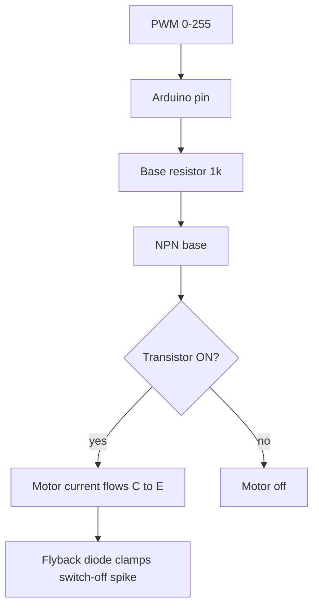

## For future agent
This is the **hardware spine** for the whole [[01-Areas/Engineering/arduino-microcontrollers/INDEX|Arduino module]]: it consolidates facts scattered across Episodes 1–10 into one reference (board architecture, every pin, current limits, VDR, DC-motor and power wiring) plus per-episode connection tables. Values are for the classic **Arduino Uno R3 / ATmega328P @ 16 MHz**; clones may use a CH340 USB chip instead of the ATmega16U2, and some "Uno" variants use different regulators. Electrical limits are from the ATmega328P datasheet (absolute max) — treat the comfortable values, not the absolute max, as the design target. Synthesised from the module notes and the Arduino reference; no new claims. Confidence: high for pin mapping and formulas; medium for clone-specific power limits (flagged).

# Arduino Uno — Hardware, Pins, VDR, and Motor Architecture

## 1. Board architecture (what is actually on the board)

An Arduino Uno is not a single chip — it is a small **development board** wrapped around a microcontroller, plus the glue that makes it easy to program over USB.

```
   USB-B ── USB-serial chip ── UART ──┐
                                      │
   Barrel jack / VIN ── regulator ── 5V rail ── ATmega328P ── digital/analog pins
                          └─ 3.3V regulator ── 3V3 pin          │
                                      │                          │
                                    ICSP (6-pin) ────────────────┘
```

| Block | Part / spec | What it means |
|-------|-------------|---------------|
| Microcontroller | **ATmega328P** | 8-bit AVR CPU, the "brain" |
| Clock | **16 MHz** crystal | one clock tick ≈ 62.5 ns; one instruction ≈ 1 clock (some 2) |
| Flash | **32 KB** (0.5 KB used by bootloader) | program storage; ~31.5 KB for your sketch |
| SRAM | **2 KB** | variables, stack, buffers; Strings can exhaust this fast |
| EEPROM | **1 KB** | survives power-off; for calibration/settings |
| Digital I/O | **14** (D0–D13) | 6 support PWM; D2/D3 support external interrupts |
| Analog inputs | **6** (A0–A5) | 10-bit ADC; A4/A5 double as I2C |
| UART | **1** (D0/D1) | hardware serial, shared with USB |
| I2C | **1** (A4/A5) | `Wire` library |
| SPI | **1** (D10–D13) | `SPI` library |
| USB-serial | **ATmega16U2** (official) / **CH340** (many clones) | converts USB to UART; this is what `Serial` talks to |
| Regulators | 5 V and 3.3 V | from barrel jack/VIN or USB |
| Power input | USB 5 V, or barrel jack **7–12 V** recommended (6–20 V limit) | onboard regulator tolerates a range but heats up at higher input |
| Built-in LED | **D13** | with a series resistor on the board — explains Ep01's "no external resistor" blink |

**Memory discipline (matters by Ep06+):** 2 KB SRAM is tiny. A single `String` concatenation chain can fragment it. Prefer `char` buffers, `F("...")` for constant strings (keeps them in flash), and avoid recursion. This is why the serial notes parse with fixed expectations rather than building large strings.

---

## 2. Complete pin map (Uno R3)

### Digital side (D0–D13)

| Pin | Alternate function | Notes |
|-----|--------------------|-------|
| **D0** | **RX** (hardware UART receive) | shared with USB-serial; disconnect external link to upload |
| **D1** | **TX** (hardware UART transmit) | shared with USB-serial; same upload conflict |
| **D2** | **INT0** (external interrupt) | `attachInterrupt(digitalPinToInterrupt(2), ...)` |
| **D3** | **INT1**, **PWM** (`~`) | second external interrupt |
| **D4** | — | plain digital |
| **D5** | **PWM** (`~`) | `analogWrite` |
| **D6** | **PWM** (`~`) | `analogWrite` |
| **D7** | — | plain digital |
| **D8** | — | plain digital |
| **D9** | **PWM** (`~`) | servo signal in Ep05/Ep09 |
| **D10** | **PWM** (`~`), **SS** (SPI slave select) | SS is **active low**; you drive it manually |
| **D11** | **PWM** (`~`), **MOSI** (SPI master-out/slave-in) | SPI data out |
| **D12** | **MISO** (SPI master-in/slave-out) | SPI data in |
| **D13** | **SCK** (SPI clock), **built-in LED** | LED + resistor onboard |

**PWM pins (`~`): 3, 5, 6, 9, 10, 11.** `analogWrite` works only on these. Two of them (5 and 6) run at a different timer frequency than the rest — relevant for timers/audio but not for Ep02/Ep05 motor speed.

**External interrupt pins: 2 and 3 only** on the Uno. `attachInterrupt` on any other pin silently does nothing (Ep10's most common trap).

### Analog side (A0–A5)

| Pin | Also digital | Special function |
|-----|--------------|------------------|
| **A0** | D14 | `analogRead(A0)` — photoresistor (Ep04), pot, Sharp IR |
| **A1** | D15 | analog in |
| **A2** | D16 | analog in |
| **A3** | D17 | analog in |
| **A4** | D18 | **SDA** — I2C data (Ep07) |
| **A5** | D19 | **SCL** — I2C clock (Ep07) |

Analog pins can be used as digital pins D14–D19 (`pinMode(A0, OUTPUT)` etc.). The ADC is **10-bit: 0–1023 over 0–5 V**, ≈ **4.883 mV per step** ($5.0/1024$). `analogRead` takes ~100 µs.

### Power and control pins

| Pin | Meaning | Notes |
|-----|---------|-------|
| **VIN** | raw input to the 5 V regulator | 7–12 V recommended; do not feed 5 V here expecting a clean rail |
| **5V** | regulated 5 V output (or USB 5 V) | can power small sensors; **not** for motors/servos (current spikes) |
| **3V3** | 3.3 V output from the onboard regulator | low current (~50 mA on official boards; clone-dependent) |
| **GND** | ground reference (multiple pins) | all GND pins are the same net |
| **AREF** | analog reference | advanced; leave alone unless you know you need it |
| **RESET** | pull LOW to reset | same as the reset button |
| **IOREF** | logic voltage reference | shields use it to detect 5 V vs 3.3 V |
| **ICSP** | 6-pin in-circuit serial programming | SPI pins broken out for bootloader/firmware |

### Quick pin lookup by job

| Job | Pins |
|-----|------|
| PWM / dimming / motor speed | 3, 5, 6, 9, 10, 11 |
| External interrupt | 2, 3 |
| I2C (SDA/SCL) | A4 / A5 |
| SPI (SS/MOSI/MISO/SCK) | 10 / 11 / 12 / 13 |
| UART (RX/TX) | 0 / 1 |
| Analog read | A0–A5 |
| Built-in LED | 13 |
| Servo signal (any digital pin) | 9 in the series |

---

## 3. Electrical limits (do not exceed)

| Quantity | Comfortable design target | Absolute max (datasheet) | Consequence of exceeding |
|----------|---------------------------|--------------------------|--------------------------|
| Current per I/O pin | **~20 mA** | **40 mA** | pin/ATmega damage |
| Total current through chip (all I/O) | keep well under ~200 mA | ~200 mA per VCC/GND group | overheating, brown-out |
| 3.3 V pin current | small sensors only | ~50 mA (official) | regulator overheating |
| 5 V pin current | sensors/logic, not motors | bounded by USB (~500 mA) or regulator | resets, USB port protection trips |
| Voltage on any I/O pin | 0–5 V | −0.5 to +5.5 V | latch-up/destruction |
| Analog input voltage | 0–5 V | 0–VCC | clamp/ damage above VCC |

**Design rule:** the board *decides*, external hardware *delivers power*. A pin drives a signal or a transistor's base — never a motor, never a servo's power wire, never a relay coil directly.

**Why 40 mA is not a suggestion:** the ATmega's output driver is a tiny transistor. A motor's stall current can be 10–50× the running current. Even a "small" motor can pull an amp at stall, which is 25× the absolute pin max.

---

## 4. Voltage Divider Rule (VDR) — derivation and use

### Derivation from Ohm's law

Two resistors in **series** across $V_{in}$ carry the **same current**:

$$I = \frac{V_{in}}{R_1+R_2}$$

The output is taken across $R_2$, so:

$$V_{out} = I\,R_2 = V_{in}\cdot\frac{R_2}{R_1+R_2}$$

The ratio $\frac{R_2}{R_1+R_2}$ is always between 0 and 1: a divider can only **scale down**, never up.

```
        R1
 +5V ──[####]──┬── Vout ──> A0 / next stage
               │
              [####] R2
               │
              GND
```

The current through the divider is a **cost**: a 10 kΩ + 10 kΩ divider across 5 V draws 0.25 mA continuously. A low-resistance divider is stiffer (less affected by load) but wastes more current; a high-resistance divider saves power but sags when loaded.

### Worked examples

1. **Equal resistors, 5 V.** $R_1=R_2=10\,k\Omega$: $V_{out}=5\times\frac{10k}{20k}=2.5$ V.
2. **Sensor divider (Ep04).** An LDR (resistance falls with light) on top, fixed 10 kΩ on the bottom, 5 V across. In bright light the LDR drops to ~1 kΩ: $V_{out}=5\times\frac{10k}{1k+10k}\approx4.55$ V. In darkness the LDR rises to ~1 MΩ: $V_{out}\approx5\times\frac{10k}{1.01M}\approx0.05$ V. Bright → high reading. **Swap the LDR to the bottom and the direction inverts** — the classic "night light works backwards" bug.
3. **5 V → 3.3 V logic level shift.** To feed a 5 V TX into a 3.3 V RX: choose $R_1=1\,k\Omega$ (top), $R_2=2\,k\Omega$ (bottom): $V_{out}=5\times\frac{2}{3}=3.33$ V. This is a **one-way** divider; for bidirectional level shifting use a proper converter module.
4. **Potentiometer as a variable divider.** A 10 kΩ pot wired end-to-end across 5 V and GND is two resistors whose values trade off as the wiper moves. At one extreme $R_2\approx0$ (0 V), at the other $R_2\approx10k$ (5 V), midpoint 2.5 V. That is why a pot is the canonical analog knob.
5. **Loaded divider warning.** If you draw current from the $V_{out}$ node, that current flows through $R_1$ too, so the output sags. **Dividers are for signals, not for powering loads.** Use a regulator for power.

### Divider → ADC → engineering units

The ADC reads the divided voltage and returns a count:

$$V_{measured}=V_{out}=\text{count}\times\frac{5.0}{1023}$$

Combine with the divider to recover the sensor resistance or the real input voltage. For a known divider ratio $k=R_2/(R_1+R_2)$:

$$V_{in}=\frac{V_{out}}{k}$$

Always **calibrate** thresholds from live readings; resistor tolerances (often ±5%) make the theoretical value approximate.

---

## 5. DC motor architecture (Ep05, expanded)

### Why the pin cannot drive it

| Device | Current draw | Can the pin drive it? |
|--------|--------------|-----------------------|
| LED | 5–20 mA | yes, with a series resistor |
| Small servo (moving) | 100–500 mA spikes | **no** — power from a separate rail |
| Small DC motor (running) | 100–500 mA | **no** — use a transistor/driver |
| DC motor (stall) | 1–5 A | **no** — the pin would be destroyed instantly |

### The standard low-side NPN switch

```
              +9V (motor supply)
               │
            [ MOTOR ]
               │
               ├──────────────┐
               │              │
              (C)          [1N4004]   cathode to +9V, anode to collector
   pin 9 ──[1k]──(B)  BC547     │
               │              │
              (E)─────────────┘
               │
              GND ──────────── GND (shared with Arduino GND!)
```

**Every part has a job:**

| Part | Job | Why |
|------|-----|-----|
| **BC547 NPN** | electronic switch | small base current controls large collector–emitter current |
| **1 kΩ base resistor** | limits base current | protects the pin and the base junction; sets how hard the transistor turns on |
| **1N4004 flyback diode** | clamps the inductive kick | motor coil generates a large reverse voltage when switched off; the diode gives it a safe loop |
| **Separate +9 V (or +5 V) motor supply** | provides the current | the Arduino pin only supplies the control signal |
| **Common ground** | reference | without it the base-emitter voltage is undefined and the switch never works |
| **PWM on the base** | speed control | `analogWrite(9, 0..255)` varies average motor voltage |

### Sizing the base resistor (why 1 kΩ)

$$I_B=\frac{V_{pin}-V_{BE}}{R_B}\approx\frac{5-0.7}{1000}=4.3\ \text{mA}$$

The transistor's DC gain $h_{FE}$ (BC547: roughly 100–800, datasheet-dependent) multiplies base current into collector current:

$$I_C \approx h_{FE}\cdot I_B$$

At $h_{FE}=100$, $I_C\approx430$ mA — enough for a small motor. For a larger motor, either use a lower $R_B$ (more base current, check the pin's 20 mA budget), a **Darlington** pair, or a **MOSFET** (voltage-driven, no base current). If the transistor gets hot, it is not fully saturated: the base drive is too weak for the load, and the leftover voltage across C–E becomes heat ($P=V_{CE}\cdot I_C$).

### Direction control: the H-bridge

The single NPN only switches one way. To go **forward and reverse**, you need to reverse the polarity across the motor. Four switches in an "H" do that:

- **L293D** — dual H-bridge, ~600 mA per channel continuous, common in kits.
- **L298N** — dual H-bridge, higher current, needs a heatsink, often on a module with its own 5 V regulator.
- Built-in protection diodes on the L293D/L298N handle flyback.

Direction is to a DC motor what angle is to a servo: the missing degree of freedom.



### Motor wiring checklist

1. Motor on its **own supply**, not the Arduino 5 V pin.
2. Transistor **collector to motor**, **emitter to GND**, **base through 1 kΩ to pin**.
3. **Flyback diode across the motor**, cathode to the **positive** supply.
4. **Common ground** between motor supply and Arduino.
5. PWM pin must be a `~` pin.
6. For direction, use an H-bridge (L293D/L298N), not two random transistors.
7. Add a **decoupling capacitor** across the motor terminals (e.g. 0.1 µF) to reduce brush noise.

---

## 6. Power architecture

| Source | Path | Notes |
|--------|------|-------|
| USB | 5 V directly to the 5 V rail (through a fuse/protection) | convenient; limited to ~500 mA; also carries programming |
| Barrel jack / VIN | 7–12 V → onboard 5 V regulator | regulator dissipates the drop as heat; >12 V gets hot |
| 5V pin | direct connection to the 5 V rail | can back-feed the board; avoid powering from both USB and 5V carelessly |
| 3V3 pin | onboard 3.3 V regulator | low current; do not power motors from it |

**Rail separation rule:** logic (Arduino) and power (motors/servos) share **GND** but not **5 V**. Give motors their own supply (battery → 7805/LM2596 → motor rail as needed), and tie the grounds. Servo current spikes are the classic cause of "the board resets when the motor moves."

**Decoupling capacitors:** a ceramic (0.1 µF) near a chip's supply pins, and bulk electrolytics (10–100 µF) on rails, absorb fast transients. The 7805 (Ep03) also needs input/output capacitors to stay stable.

---

## 7. Per-episode connection table

| Ep | Build | Key pins | Connections / parts | Safety note |
|----|-------|----------|---------------------|-------------|
| 01 | Blink | D13, GND | built-in LED, USB | none — pin 13 has an onboard resistor |
| 02 | Button + PWM LED | D2 (button), D9 (`~`) | button + 10 kΩ pull-down; LED + 150–330 Ω | no floating input; debounce |
| 03 | Theory + pot divider | A0, 5V, GND | two resistors / 10 kΩ pot; 7805 + caps | current measured in series; regulator heat |
| 04 | Analog sensor | A0, D9 (`~`) | LDR divider or Sharp IR analog out; LED | calibrate threshold; never exceed 5 V on A0 |
| 05 | DC motor + servo | D9 (`~`), D9 servo, 5V/GND | BC547, 1 kΩ, 1N4004, 9 V motor supply; 7805 servo rail | flyback diode mandatory; separate rail; common GND |
| 06 | Serial + Processing | D0/D1 (USB), D13 | USB cable; Processing on PC | baud match; ASCII vs number; `flush` change |
| 07 | I2C temperature | A4 (SDA), A5 (SCL) | TC74 @ address 72; pull-ups (often onboard) | one pull-up pair per bus; short distance |
| 08 | SPI digital pot | D10 (SS), D11 (MOSI), D12 (MISO), D13 (SCK) | MCP42010, LEDs, 10 kΩ to GND on B side | SS active low; slow clock (DIV16); register 0 |
| 09 | XBee wireless | D2/D3 (SoftwareSerial) or D0/D1 | XBee 3.3 V + shield/explorer; PAN/MY/DL matched | **3.3 V only**; clean regulated supply |
| 10 | Interrupt + debounce | D2 (INT0), D13 | switch/beam-break; 74HC14 + RC for hardware debounce | `volatile`; ISR short; no `Serial` in ISR |
| Link | Two-Arduino UART | D2/D3 (SoftwareSerial) or D0/D1 | 3 wires: TX↔RX, RX↔TX, GND | common GND; 5 V→3.3 V level shift |

---

## 8. Common hardware pitfalls

1. **Driving a motor/servo from a pin or the 5 V pin.** Current spike → dead pin or reset board.
2. **Omitting the flyback diode.** The inductive kick destroys the transistor.
3. **No common ground between logic and motor supplies.** The control signal has no reference.
4. **Floating input.** Reads noise; add a pull-up/pull-down or `INPUT_PULLUP`.
5. **Forgetting the LED resistor.** LED and/or pin dies.
6. **`analogWrite` on a non-`~` pin.** It becomes plain on/off.
7. **`analogRead` above 5 V.** Clamps/damages; use a divider.
8. **Using D0/D1 for a link while uploading.** Upload fails; disconnect the link.
9. **`attachInterrupt` on a non-2/3 pin.** Silently ignored on the Uno.
10. **Sharing 5 V between two boards casually.** One regulator back-feeds the other.
11. **Ignoring resistor power rating.** $P=I^2R$; a small resistor can overheat.
12. **Assuming all "Unos" are identical.** Clones differ in USB chip, regulator, and 3.3 V current — verify.
13. **Long I2C/SPI wires.** Capacitance corrupts the bus; keep buses short.
14. **5 V into a 3.3 V XBee/ESP.** Destroys the module; level shift.

---

## 9. Practice problems

1. **Pin triage.** For each job, name the pins: (a) read a potentiometer, (b) dim an LED, (c) attach an interrupt, (d) connect an I2C sensor, (e) connect an SPI SD card, (f) talk to a PC.
2. **Current budget.** You want 8 LEDs at 15 mA each. Can the chip supply all of them at once? What is the total, and what is the safe per-pin current?
3. **LED resistor.** A green LED has $V_f=2.1$ V, target 12 mA, from a 5 V pin. Compute $R$ and the nearest standard value.
4. **VDR design.** Design a divider to read a 0–12 V sensor on a 0–5 V ADC. Pick $R_1$ and $R_2$ so $V_{out}=5$ V at $V_{in}=12$ V. What current does the divider draw if $R_1+R_2=100\,k\Omega$?
5. **Level shifting.** You must link a 5 V Uno TX to a 3.3 V ESP32 RX. Draw the divider and compute $V_{out}$ for $R_1=1.8\,k\Omega$, $R_2=3.3\,k\Omega$.
6. **Base resistor.** A motor needs 300 mA; $h_{FE}=150$, $V_{BE}=0.7$ V, pin = 5 V. What $I_B$ is required? What $R_B$ gives it, and is it within the pin's 20 mA budget?
7. **Motor wiring.** Draw the complete low-side NPN circuit for a 9 V motor, label every component, and mark the diode orientation.
8. **Power plan.** You have a 9 V battery, a 7805, an Uno on USB, a servo, and a DC motor. Describe which rail powers what and where the grounds tie.
9. **Debug a dead motor.** The motor does not spin. List five things to check, in order of likelihood.
10. **Architecture question.** Why can the Uno's 3.3 V pin not power a servo, and what should you use instead?

### Answer hints

1. (a) A0–A5; (b) 3/5/6/9/10/11; (c) 2 or 3; (d) A4/A5; (e) 10/11/12/13; (f) 0/1 (USB).
2. $8\times15=120$ mA total; fine for the chip if spread across pins, but keep each pin ≤20 mA and total well under ~200 mA. Check the 5 V source budget.
3. $R=(5-2.1)/0.012\approx242\,\Omega$ → use **270 Ω** (or 220 Ω if brighter is acceptable).
4. $R_2/(R_1+R_2)=5/12$. With $100\,k\Omega$ total: $R_2=41.7\,k\Omega$, $R_1=58.3\,k\Omega$ → use 47 kΩ / 56 kΩ (ratio close). Current $=12/100k=0.12$ mA.
5. $V_{out}=5\times\frac{3.3}{1.8+3.3}=3.24$ V — safe.
6. $I_B=I_C/h_{FE}=300/150=2$ mA. $R_B=(5-0.7)/0.002\approx2.15\,k\Omega$ → 2.2 kΩ; 2 mA is within budget.
7. See §5: +9 V → motor → collector; emitter → GND; base → 1 kΩ → pin; 1N4004 across motor, **cathode to +9 V**.
8. USB powers the Uno logic; 7805 from the 9 V battery powers the servo rail; the motor gets the battery/motor rail through the transistor; all grounds tied; never power the servo from the Uno 5 V pin.
9. Supply/ground; base resistor/transistor orientation; diode orientation; PWM pin is a `~` pin and code writes it; motor itself (test on a battery); common ground.
10. The 3.3 V pin's regulator is low-current; a servo's spikes exceed it and brown out the board/motor. Use a separate regulated 5 V rail (7805/buck) with a common ground.

---

## Cross-Links

- [[01-Areas/Engineering/arduino-microcontrollers/INDEX|Arduino Module Index]]
- [[01-Areas/Engineering/arduino-microcontrollers/ep01-getting-acquainted|Episode 01 — Getting Acquainted]] — board, IDE, pin 13.
- [[01-Areas/Engineering/arduino-microcontrollers/ep02-buttons-pwm-functions|Episode 02 — Buttons & PWM]] — digital I/O, PWM pins.
- [[01-Areas/Engineering/arduino-microcontrollers/ep03-electrical-basics|Episode 03 — EE Basics]] — VDR, regulators, resistors.
- [[01-Areas/Engineering/arduino-microcontrollers/ep04-analog-inputs|Episode 04 — Analog Inputs]] — ADC, sensor dividers.
- [[01-Areas/Engineering/arduino-microcontrollers/ep05-motors-transistors|Episode 05 — Motors & Transistors]] — the motor chain.
- [[01-Areas/Engineering/arduino-microcontrollers/ep07-i2c-communication|Episode 07 — I2C]] · [[01-Areas/Engineering/arduino-microcontrollers/ep08-spi-interfaces|Episode 08 — SPI]] · [[01-Areas/Engineering/arduino-microcontrollers/ep09-wireless-communication|Episode 09 — Wireless]] · [[01-Areas/Engineering/arduino-microcontrollers/ep10-interrupts-debouncing|Episode 10 — Interrupts]] — bus and interrupt pins.
- [[01-Areas/Engineering/arduino-microcontrollers/two-arduino-serial-communication|Two-Arduino Wired Serial]] — UART pins and level shifting.
- [[01-Areas/Engineering/arduino-microcontrollers/revision-ep06-ep10-test|Ep06–10 Revision & Self-Test]]
- [[01-Areas/Engineering/BEE/INDEX|Basic Electrical Engineering]] — formal DC circuit theory behind the VDR.
