## For future agent
This note covers Episode 1 of Jeremy Blum's Arduino Tutorial Series (`fCxzA9_kg6s`). It is beginner-facing: it explains what a microcontroller and the Arduino platform are, how to install the Arduino IDE and the Windows USB driver, how to select the board and COM port, and how to write and upload the canonical "Blink" sketch. The code shown is Jeremy's original `ledPin = 13` blink program plus the standard Arduino `setup()`/`loop()` skeleton. Everything here is stable knowledge (Arduino C is not version-fragile), but IDE menu names and driver-install steps changed after IDE 1.0/2.x — flagged inline where the video (2011) differs from a modern install. Confidence: high, with modern-difference caveats marked `(modern)`.

# Episode 01 — Getting Acquainted with Arduino

## Episode Overview

This is the foundation episode of the whole series. Before you can blink an LED, read a sensor, or drive a motor, you need three things working together: a board, a toolchain, and a mental model of how Arduino programs are structured. Episode 1 delivers exactly those. It does not assume you have ever touched a microcontroller, breadboard, or electronics—only that you can install software and plug in a USB cable.

The episode has three movements:

1. **Orientation** — what the Arduino is, why it exists, and what the Arduino Uno (the "flagship" board in 2011) looks like.
2. **Setup** — download the IDE, install the Windows driver, select the right board and port, and understand the tiny gotcha that trips up most first-timers on the Uno.
3. **First program** — write, compile, and upload the Blink sketch that toggles the built-in LED on pin 13 once per second, then watch it flash on the physical board.

By the end you will have the exact loop of **edit → compile → upload → observe** that every future episode builds on. Everything else in this module is "what to do inside `loop()`, `setup()`"; this episode is "how do I get anything at all running."

### Learning objectives
- Explain the difference between a microcontroller, a computer, and the Arduino platform.
- Install the Arduino IDE and the correct USB driver for an Uno on Windows.
- Select the correct board (`Tools → Board`) and serial port (`Tools → Port`).
- Read and write the required `setup()` and `loop()` functions.
- Use `pinMode()`, `digitalWrite()`, and `delay()` to blink pin 13.
- Understand `//` vs `/* */` comments and why constants live at the top of a sketch.
- Upload a sketch and physically verify the LED blinks.

---

## Core Concepts (ELI5)

### What is a microcontroller?
Think of a microcontroller as a **tiny, cheap, single-purpose computer on a chip**. A laptop has a big CPU, gigabytes of RAM, a screen, and an operating system that runs thousands of programs. A microcontroller (like the Atmel ATmega328P on the Uno) has a small CPU, a few kilobytes of RAM, no screen, and no operating system. It runs **one program that you wrote**, forever, the moment you power it on. That single-mindedness is the point: it turns it on, reads its inputs, drives its outputs, and repeats, thousands of times per second, with no boot-up lag and no crashes from other apps.

**Analogy:** a laptop is a bustling office building with hundreds of workers doing different jobs. A microcontroller is a single dedicated employee who does exactly one routine perfectly, forever, without getting bored. For blinking an LED, reading a thermometer, or steering a robot wheel, you do not want the office building; you want the dedicated employee.

### What is Arduino (the platform)?
The Arduino is **not a single chip**; it is a whole ecosystem: a physical board, a software IDE, and a simple programming language layered on top of C/C++. Before Arduino, programming a microcontroller meant reading a 500-page datasheet, hand-configuring hardware fuse bits, and buying a separate programmer. Arduino wraps all that up: the board has a USB port that both powers it and programs it, and the language hides the register-level details behind friendly words like `pinMode()` and `digitalWrite()`. "Arduino" is the friendly front door; underneath, it is a microcontroller doing real electronics.

### Digital output and pins
The board has rows of metal sockets called **pins**. Each digital pin is a tiny switch that can be either **HIGH (5 volts, "on")** or **LOW (0 volts, "off")**. When you tell a pin to go HIGH, 5 V appears on it; connect an LED between that pin and ground and the LED lights up. Pins are numbered (0–13 on the Uno for digital), plus a separate group of analog input pins (A0–A5). **Pin 13 is special:** the Uno has a tiny LED already soldered to it, so you can prove your whole toolchain works without wiring a single external component. That is why the first program always uses pin 13.

### The sketch
An Arduino program is called a **sketch**. It is stored as a plain text file (`.ino`) and always contains two required functions: `setup()` and `loop()`. `setup()` runs **once** when the board powers on or resets. `loop()` runs **over and over, forever**, as long as the board has power. This two-part structure is the skeleton of every Arduino program you will ever write in this series.

---

## Code Walkthrough

Here is Jeremy's first program, annotated line by line. This is the "Blink" sketch, adapted from the standard Arduino example.

```cpp
/*
  Jeremy Blum's first Arduino program.
  Blinks the built-in LED on pin 13 once per second.
*/

int ledPin = 13;   // the built-in LED is wired to digital pin 13

void setup() {
  // Runs ONCE, when the board powers on or is reset.
  // "pinMode" tells the board whether a pin is an INPUT or an OUTPUT.
  pinMode(ledPin, OUTPUT);   // we want to drive the LED, so it's an OUTPUT
}

void loop() {
  // Runs FOREVER, top to bottom, over and over.
  digitalWrite(ledPin, HIGH);  // turn the LED ON  (5 volts)
  delay(1000);                 // wait 1000 milliseconds = 1 second
  digitalWrite(ledPin, LOW);   // turn the LED OFF (0 volts)
  delay(1000);                 // wait another second
}
```

### Line-by-line reasoning

**The comment block.** `/* ... */` is a **multi-line comment**. The compiler ignores everything inside it. Jeremy opens his sketch with a comment describing what it does—a habit worth copying, since six months later the file name alone will not remind you of the intent. A single-line comment uses `//`, which tells the compiler "ignore the rest of this line."

**`int ledPin = 13;`** — This declares a **variable**. `int` means "integer" (a whole number). The variable is named `ledPin` and holds the value `13`. Why bother, when you could just type `13` everywhere? Because "13" is a *magic number*—it means nothing on its own. `ledPin` documents itself. This line sits **above** `setup()`, at the top of the file, so it is a **global** variable visible to every function below it. Jeremy's rule: define your constants at the top of the program, in one place.

**`void setup() { ... }`** — The word `void` means "this function returns nothing." `setup()` is called exactly once by the Arduino runtime. Every bracket `{ }` block is a **function body**. Inside it, we do one-time configuration. Here, `pinMode(ledPin, OUTPUT)` configures pin 13 to be an output, meaning the board is allowed to *drive* that pin (push voltage out of it). If you forget this, the pin floats and the LED behaves unpredictably.

**`void loop() { ... }`** — After `setup()` finishes, the runtime calls `loop()` and calls it again the moment it returns, forever. There is no `exit`; the program is an infinite cycle. This is intentional: microcontrollers are designed to run a repeating control loop.

**`digitalWrite(ledPin, HIGH);`** — Drives pin 13 to 5 V, lighting the LED. `HIGH` and `LOW` are Arduino constants meaning "on" and "off." Note the semicolon `;` at the end of every statement—forgetting it produces a compile error.

**`delay(1000);`** — Pauses the program for **1000 milliseconds** (1 second). Crucially, `delay()` **blocks**: the board does nothing else during that second—it cannot read buttons or sensors. That limitation gets fixed in later episodes (including interrupts in Episode 10). For a first blink, it is perfect.

**Why the LED doesn't need a resistor here.** A normal LED wired to a pin needs a **current-limiting resistor** (Episode 3 explains exactly why). The built-in LED on pin 13, however, already has a resistor on the board, so you can drive it bare. This is another reason episode 1 uses pin 13: zero external parts, zero risk.

### The full toolchain flow

```
   You write sketch        Arduino IDE compiles        USB upload         Board runs
   (edit .ino file)  -->   (turns C++ into         -->  it onto the    -->  setup() once
                            machine code, checks         ATmega chip        loop() forever
                            for syntax errors)
```

Mermaid version of the blink logic:

```mermaid
flowchart TD
    A[Power on / Reset] --> B[setup&#40;&#41; runs once<br/>pinMode&#40;13, OUTPUT&#41;]
    B --> C[Enter loop&#40;&#41;]
    C --> D[digitalWrite&#40;13, HIGH&#41;<br/>LED ON]
    D --> E[delay&#40;1000&#41;<br/>wait 1 second]
    E --> F[digitalWrite&#40;13, LOW&#41;<br/>LED OFF]
    F --> G[delay&#40;1000&#41;<br/>wait 1 second]
    G --> C
```



### The setup procedure (as Jeremy demonstrates it)

1. **Download the IDE** from arduino.cc. On Windows it arrives as a ZIP; extract it (no installer) and run the program.
2. **Save the sketch first** with `File → Save`. Arduino *always* stores a sketch inside a folder with the **same name** as the sketch—this is a hard rule, not a suggestion.
3. **Select the board:** `Tools → Board → Arduino Uno`. If you are using a different model, pick the matching entry from the drop-down. A wrong board selection is the #1 cause of upload failures.
4. **Plug in the USB cable.** The board lights up.
5. **Install the Windows driver for the Uno.** The Uno uses a different USB chip than older boards, so Windows does not auto-install it. Go to `Start → Control Panel → System and Security → System → Device Manager`, find "Arduino Uno" (often flagged with a yellow warning), choose **Update Driver Software → Browse my computer**, and point it at the `drivers` folder inside the Arduino download. It may warn that the publisher cannot be verified; proceed anyway. *(modern)* On Arduino IDE 2.x and current Windows, this step is usually automatic; the manual driver dance is a 2011-era instruction kept here because it teaches you where the drivers live.
6. **Select the port:** `Tools → Port → COM…`. You must pick the port Windows assigned to the board. With the wrong port, the upload silently fails.
7. **Click Upload.** The IDE compiles, then streams the code to the board over USB. When it says "Done uploading," the sketch is live.

---

## Key Functions Reference

| Function | Syntax | What it does | Example |
|----------|--------|--------------|---------|
| `setup` | `void setup() { }` | Runs once at power-on/reset; configuration goes here. | `void setup(){ pinMode(13, OUTPUT); }` |
| `loop` | `void loop() { }` | Runs repeatedly forever; the main behavior goes here. | `void loop(){ digitalWrite(13, HIGH); }` |
| `pinMode` | `pinMode(pin, mode)` | Sets a pin to `INPUT` or `OUTPUT`. | `pinMode(ledPin, OUTPUT);` |
| `digitalWrite` | `digitalWrite(pin, value)` | Drives a pin `HIGH` (5 V) or `LOW` (0 V). | `digitalWrite(13, HIGH);` |
| `delay` | `delay(ms)` | Blocks for the given milliseconds. 1000 ms = 1 s. | `delay(1000);` |
| Constants | `HIGH`, `LOW`, `OUTPUT`, `INPUT` | Built-in keywords, no `#define` required. | `digitalWrite(13, LOW);` |

---

## Common Pitfalls / Gotchas

1. **Round brackets instead of curly braces around function bodies.** A classic beginner error: writing `void setup() ( ... )` instead of `void setup() { ... }`. Jeremy answered this exact question on his blog ("You need to use curly braces when defining the contents of a function"). Fix: `()` only ever hold arguments; `{}` hold the body.
2. **Missing semicolons.** Every statement ends in `;`. A missing one produces a confusing error on the *next* line, not the line you forgot.
3. **Wrong board or wrong port selected.** The upload fails with cryptic errors (`avrdude: stk500_getsync(): not in sync`). Fix: double-check `Tools → Board` and `Tools → Port`.
4. **Sketch folder name mismatch.** A sketch must live in a folder of the same name. If you rename the folder, reopen the sketch from inside it.
5. **Windows driver not installed on the Uno.** The upload port may not even appear. Fix: install the driver from the IDE's `drivers` folder (or use a modern IDE that auto-installs).
6. **Expecting `loop()` to end.** It never terminates. Code after `loop()` never runs; if you need one-time behavior, put it in `setup()`. (See the Tika comment on the blog about a variable defined globally vs. in `loop()`.)
7. **Using `delay()` for everything.** Fine here, but it blocks—remember this when you reach buttons and interrupts.

---

## Practice Exercises

1. **Slow blink.** Change both `delay(1000)` calls to `delay(250)`. Upload and confirm the LED flashes four times a second. Then try `delay(100)`—does it still look like blinking or a faint flicker? This is your first taste of timing.
2. **Asymmetric blink.** Make the LED stay on for 2 seconds and off for a quarter second. This teaches that `delay()` values are independent and sequential.
3. **Second built-in indicator.** Add a second `digitalWrite(ledPin, HIGH)` before a `delay(200)` to create a double-blink pattern. Predict the pattern before you upload.
4. **Comment discipline.** Delete every comment and try to re-understand the sketch cold. Then rewrite comments that would let a stranger (or future you) understand it in isolation.
5. **Break it on purpose.** Remove the semicolon after `digitalWrite(ledPin, HIGH)` and read the compiler error. Learning to read errors is a skill; do it deliberately here where you know the cause.

---

## Cross-Links

- [[01-Areas/Engineering/arduino-microcontrollers/INDEX|Arduino Module Index]] — episode map and scope.
- [[01-Areas/Engineering/arduino-microcontrollers/ep02-buttons-pwm-functions|Episode 02 — Buttons, PWM, Functions]] — next step: reading input and varying brightness.
- [[01-Areas/Engineering/BEE/INDEX|Basic Electrical Engineering]] — the voltage/current theory behind what a pin actually does.
- [[01-Areas/Engineering/SPM/module-1-spm-c-basics|SPM Module 1 — C Basics]] — the compilation pipeline; an Arduino sketch is C++ compiled for a microcontroller.
- [[01-Areas/Programming/c-interview-revision-plain-language|C Interview Revision (plain language)]] — `setup()`/`loop()` are ordinary functions; the C constructs transfer directly.
- [[01-Areas/Engineering/nexus-robotics/nexus-c-embedded-drills|Nexus Robotics — Embedded C Drills]] — where these fundamentals become interview-ready.
