## For future agent
This note covers Episode 2 of Jeremy Blum's Arduino Tutorial Series. It teaches digital **input** for the first time: `digitalRead()`, the floating-input problem, pull-down resistors, mechanical switch bounce, a reusable `debounce()` function, and PWM brightness control via `analogWrite()`. Two programs are analysed: a simple button-controlled LED, and a PWM dimmer driven by button presses. The `debounce()` pattern here is the software version later replaced by hardware debouncing in Episode 10 — keep both in mind. Code and concepts are stable (Arduino C), but the video predates Arduino 1.0; any version-sensitive notes are flagged. Confidence: high.

# Episode 02 — Buttons, PWM, and Functions

## Episode Overview

Episode 1 taught the board to *output*—to turn an LED on and off. Episode 2 takes the other half of the fundamental I/O pair: **input**. It shows how to read a push button, why a bare button gives unreliable readings, how to fix that in software (debouncing), how to package that fix into a reusable function, and how to go beyond on/off to *variable* brightness using Pulse Width Modulation.

The three ideas and why they matter:

1. **Digital input** — you can only make interactive projects once the board can sense the world. `digitalRead()` is the input counterpart to `digitalWrite()`.
2. **Debouncing** — a mechanical switch does not cleanly go from off to on; it "bounces" for a few milliseconds, producing many false transitions. If you do not handle this, your button will act like it was pressed several times. Every real project with a button needs a debounce strategy.
3. **Functions and PWM** — you will write your own function (`debounce()`), reinforcing that sketches are ordinary programs, and use `analogWrite()` to fade an LED instead of only switching it.

### Learning objectives
- Wire a push button with a pull-down resistor and read it with `digitalRead()`.
- Explain why an unconnected input pin "floats" and produces garbage readings.
- Describe switch bounce in plain terms and implement a software debounce.
- Write and call your own function that takes arguments and returns a value.
- Use `analogWrite()` (PWM) to set LED brightness from 0–255.
- Detect a *button press event* (a transition) rather than a button *level*.

---

## Core Concepts (ELI5)

### digitalRead: asking a pin a yes/no question
`digitalWrite()` *sets* a pin; `digitalRead()` **asks** a pin whether it is HIGH (5 V) or LOW (0 V). It returns either `HIGH` or `LOW`. You must first set the pin to `INPUT` with `pinMode()`, or the board will not listen to it. Think of it as flipping a light-switch from "control the light" to "watch the light."

### The floating-pin problem
Here is the first genuinely surprising idea in electronics. If a pin is set to `INPUT` and **nothing is connected to it**, it does not read "zero." It reads **noise**—it is an antenna, picking up static from your hand, the air, and nearby wires. Engineers call this a **floating input**. The pin wobbles unpredictably between HIGH and LOW, and your `if` statements fire at random.

**Analogy:** imagine asking "is the door open?" of a room with no door at all. The answer is not "no"—the question does not apply, and any answer you get is meaningless. A floating pin is that room.

**The fix:** give the pin a *definite* resting state. Connect a resistor (here 10 kΩ) from the pin to **ground**. Now, when the button is open, a tiny trickle path pulls the pin firmly to 0 V, so it reads LOW. When you press the button, 5 V is connected directly to the pin and "wins" over the weak 10 kΩ pull-down. This is a **pull-down resistor**, and it is why the button circuit has a resistor that seems to do "nothing." (Episode 3 explains the full voltage-divider reasoning.)

```
        +5V
         |
        [BUTTON]   (open = not pressed)
         |
   pin --+----[10k]--- GND
```
Unpressed: pin is pulled to GND through 10 kΩ → reads LOW. Pressed: pin connects straight to +5 V → reads HIGH.

### Switch bounce
A push button is a piece of metal slapping against another piece of metal. On the microscopic timescale, it does not click once—it **bounces**: contact, break, contact, break, several times over a few milliseconds, before settling. To the microcontroller (which runs millions of instructions per second), those bounces look like "pressed, released, pressed, released, pressed"—so a single human press can register as several presses. **Debouncing** is smoothing that out, either in software (`delay` and re-read) or in hardware (Episode 10).

### Functions
A **function** is a named block of code you can call by name. So far you have used built-in ones (`digitalWrite`). In this episode Jeremy writes his own: a function named `debounce` that takes the previous button state and returns the (cleaned-up) current state. Functions are how you avoid copy-pasting the same logic repeatedly.

### PWM: fake analog with fast switching
A digital pin can only be fully on (5 V) or fully off (0 V). So how do you get *half* brightness? **Pulse Width Modulation** switches the pin on and off thousands of times per second. If it is on slightly more than it is off, the LED looks dim; mostly off, it looks very dim; always on, full brightness. Your eye and the LED's persistence blur the rapid switching into an average brightness. `analogWrite(pin, value)` takes a value **0–255** where 0 = always off and 255 = always on. (Note: the misleadingly named `analogWrite` is *not* a true analog voltage—it is PWM. Only certain pins, marked with a `~`, support it.)

**Analogy:** imagine a light switch flipped by a machine 500 times a second. Flip it fast enough, spending 30% of each second on, and the bulb appears 30% bright. Your eye cannot follow 500 flips per second, so it averages them.

---

## Code Walkthrough

### Program 1 — simple button-controlled LED

```cpp
// Arduino Tutorials - Episode 2
// Switch1: LED mirrors the button (button pressed = LED on)

int switchPin = 2;    // button is on digital pin 2
int ledPin = 13;      // LED is on pin 13

void setup() {
  pinMode(switchPin, INPUT);    // we READ this pin
  pinMode(ledPin, OUTPUT);      // we DRIVE this pin
}

void loop() {
  if (digitalRead(switchPin) == HIGH) {   // button pressed?
    digitalWrite(ledPin, HIGH);           // LED on
  } else {
    digitalWrite(ledPin, LOW);            // LED off
  }
}
```

**What is happening.** `digitalRead(switchPin)` checks the button. With the pull-down resistor in place, unpressed reads LOW (LED off) and pressed reads HIGH (LED on). This is a **transparent** control: the LED just follows the button in real time. If you watch carefully, you will see occasional flicker caused by bounce—the motivation for the next program.

### Program 2 — debounced toggle (press once = toggle)

This is the key program of the episode. A short press should *toggle* the LED and stay toggled, which requires detecting a **transition** (the moment the button changes), not the ongoing level.

```cpp
// Switch2/3: debounced push-button toggle

int switchPin = 2;
int ledPin = 13;

boolean lastButton = LOW;      // previous stable reading
boolean currentButton = LOW;   // current cleaned reading
boolean ledOn = false;         // LED state we are toggling

void setup() {
  pinMode(switchPin, INPUT);
  pinMode(ledPin, OUTPUT);
}

// ---- Our own debounce function ----
// Takes the previous stable state, returns the current stable state.
boolean debounce(boolean last) {
  boolean current = digitalRead(switchPin);
  if (last != current) {          // a change was detected...
    delay(5);                     // ...wait for the bounce to settle
    current = digitalRead(switchPin);  // re-read
  }
  return current;                 // hand the stable value back
}

void loop() {
  currentButton = debounce(lastButton);

  // Detect a RISING edge: was LOW, now HIGH --> a fresh press
  if (lastButton == LOW && currentButton == HIGH) {
    ledOn = !ledOn;               // toggle the state
  }

  lastButton = currentButton;     // remember for next iteration
  digitalWrite(ledPin, ledOn);    // apply the state
}
```

**Line-by-line reasoning.**

- `boolean lastButton` / `currentButton` — Boolean variables hold `true`/`false` (or equivalently `HIGH`/`LOW`; Jeremy confirms they are interchangeable). `lastButton` is the memory of the previous stable reading; `currentButton` is this pass's reading.
- `boolean debounce(boolean last)` — the function signature. Return type `boolean`; one parameter, also `boolean`. Beginners often ask where `last` is "declared"—it is the **parameter**, declared right there in the parentheses. Its value is supplied by the caller.
- `boolean current = digitalRead(switchPin);` — read the raw state. `current` is a **local** variable, existing only inside this function.
- `if (last != current) { delay(5); current = digitalRead(switchPin); }` — only when the reading *changed* do we wait 5 ms and re-read. If the state was already stable (no change), we skip the delay entirely. This conditional delay is what makes the debounce light-touch.
- `return current;` — sends the stable reading back to whoever called the function.
- In `loop()`: `currentButton = debounce(lastButton);` calls the function, passing the previous state.
- `if (lastButton == LOW && currentButton == HIGH)` — **edge detection**. We only act when the button *transitioned* from unpressed to pressed. This is what makes one press equal one toggle, rather than the LED flickering as long as you hold the button. (Compare to T4 "non-blocking debounce" in [[01-Areas/Engineering/nexus-robotics/nexus-c-embedded-drills|Nexus C drills]].)
- `lastButton = currentButton;` — update the memory. Without this, `lastButton` never changes and the edge never registers. Blog commenter "Justice Essuman" asked exactly this: it is the state-update line.
- `digitalWrite(ledPin, ledOn)` — `ledOn` is a boolean; `digitalWrite` accepts `true`/`false` as well as `HIGH`/`LOW`.

### Program 3 — PWM brightness control with a button

Jeremy's third circuit adds PWM. Each press increases brightness by a step; past full brightness it wraps back to off.

```cpp
int switchPin = 2;
int ledPin = 9;               // MUST be a PWM (~) pin for analogWrite

boolean lastButton = LOW;
boolean currentButton = LOW;
int ledLevel = 0;             // running brightness 0..255

void setup() {
  pinMode(switchPin, INPUT);
  pinMode(ledPin, OUTPUT);
}

boolean debounce(boolean last) {
  boolean current = digitalRead(switchPin);
  if (last != current) {
    delay(5);
    current = digitalRead(switchPin);
  }
  return current;
}

void loop() {
  currentButton = debounce(lastButton);
  if (lastButton == LOW && currentButton == HIGH) {  // one press
    ledLevel += 51;             // 5 presses: 0,51,102,153,204,255
    if (ledLevel > 255) ledLevel = 0;   // wrap back to off
  }
  lastButton = currentButton;
  analogWrite(ledPin, ledLevel);        // PWM out
}
```

**Why 51?** 255 ÷ 5 ≈ 51, so five presses take you from off through five brightness steps to full. `analogWrite(ledPin, 0)` = off, `…255` = full. The `if (ledLevel > 255) ledLevel = 0;` wraps the cycle.

### Logic flowchart

```mermaid
flowchart TD
    A[loop&#40;&#41; start] --> B[currentButton = debounce&#40;lastButton&#41;]
    B --> C{lastButton==LOW<br/>AND currentButton==HIGH?}
    C -- Yes, fresh press --> D[ledLevel += 51]
    D --> E{ledLevel > 255?}
    E -- Yes --> F[ledLevel = 0]
    E -- No --> G[keep ledLevel]
    F --> H[lastButton = currentButton]
    G --> H
    C -- No --> H
    H --> I[analogWrite&#40;ledPin, ledLevel&#41;]
    I --> A
```



---

## Key Functions Reference

| Function | Syntax | What it does | Example |
|----------|--------|--------------|---------|
| `digitalRead` | `digitalRead(pin)` | Returns `HIGH` or `LOW` for an input pin. | `if (digitalRead(2) == HIGH) …` |
| `analogWrite` | `analogWrite(pin, value)` | PWM output, value 0–255, on `~` pins only. | `analogWrite(9, 128);` |
| `INPUT` / `OUTPUT` | `pinMode(pin, INPUT)` | Configures pin direction. | `pinMode(2, INPUT);` |
| Custom function | `type name(type arg) { … return x; }` | Reusable logic. | `boolean debounce(boolean last){…}` |
| Type | `boolean` | Holds `true`/`false` (= `HIGH`/`LOW`). | `boolean ledOn = false;` |
| Edge detect | `if (last==LOW && current==HIGH)` | Detects a fresh press. | `ledOn = !ledOn;` |

**PWM-capable pins on the Uno:** 3, 5, 6, 9, 10, 11 (marked `~`). Using `analogWrite` on a non-PWM pin just behaves like `digitalWrite`.

---

## Common Pitfalls / Gotchas

1. **No pull-down resistor → random flicker.** The floating-input problem. Always give an input pin a defined resting state (pull-down here; `INPUT_PULLUP` in Episode 10).
2. **Using a non-PWM pin for `analogWrite`.** The LED will only be on/off. Use a `~` pin (3,5,6,9,10,11).
3. **Doing `analogWrite` where `digitalWrite` is needed** (and vice versa). `digitalWrite(9, 128)` is meaningless; `analogWrite(13, HIGH)` is wrong too.
4. **Forgetting to update `lastButton`.** The edge detector never fires and the button seems dead. Blog commenter "Justice Essuman" asked about exactly this line.
5. **Ignoring bounce.** Without debounce, one press toggles many times; the LED seems to flicker or land in a random state.
6. **Using `==` where `=` belongs (and vice versa).** In `if` tests use `==`; in assignments use `=`. A commenter's buggy `if (ledLevel = 1)` assigns rather than compares.
7. **Expecting `debounce()` to change `last` internally.** It only *reads* its parameter; the caller owns updating `lastButton`.
8. **`delay(5)` still blocks.** This debounce is simple and fine here, but it stalls the whole program for 5 ms. Non-blocking version and hardware fix come later (Ep10; [[01-Areas/Engineering/nexus-robotics/nexus-c-embedded-drills|Nexus T4]]).

---

## Practice Exercises

1. **Reverse the logic.** Make the LED on when the button is *not* pressed. Change only the condition, not the wiring. This cements the relationship between resistor topology and code.
2. **Counting presses.** Replace the toggle with a counter that increments once per press (debounced) and prints it later when you reach Episode 6's serial output. Predict what happens if you forget to debounce.
3. **Three-step dimmer.** Instead of five steps with 51, use three steps (0, 85, 170, 255) and wrap. Compute the increment yourself.
4. **Edge types.** Change the edge detector to `lastButton == HIGH && currentButton == LOW` (a *falling* edge: acting on release). Observe the different feel.
5. **Versioned debounce.** Modify `debounce()` to take a `millis`-based non-blocking check later (after Ep6); for now, write in comments how you would avoid `delay()` inside it.

---

## Cross-Links

- [[01-Areas/Engineering/arduino-microcontrollers/INDEX|Arduino Module Index]]
- [[01-Areas/Engineering/arduino-microcontrollers/ep01-getting-acquainted|Episode 01 — Getting Acquainted]] — outputs, `setup`/`loop`, `digitalWrite`.
- [[01-Areas/Engineering/arduino-microcontrollers/ep03-electrical-basics|Episode 03 — EE Basics]] — *why* the pull-down resistor and voltage divider work.
- [[01-Areas/Engineering/arduino-microcontrollers/ep10-interrupts-debouncing|Episode 10 — Interrupts & Hardware Debouncing]] — the hardware replacement for this software debounce.
- [[01-Areas/Engineering/nexus-robotics/nexus-c-embedded-drills|Nexus Robotics — Embedded C drills]] — T4 non-blocking debounce is this idea in embedded C.
- [[01-Areas/Engineering/BEE/INDEX|Basic Electrical Engineering]] — resistor divider theory.
