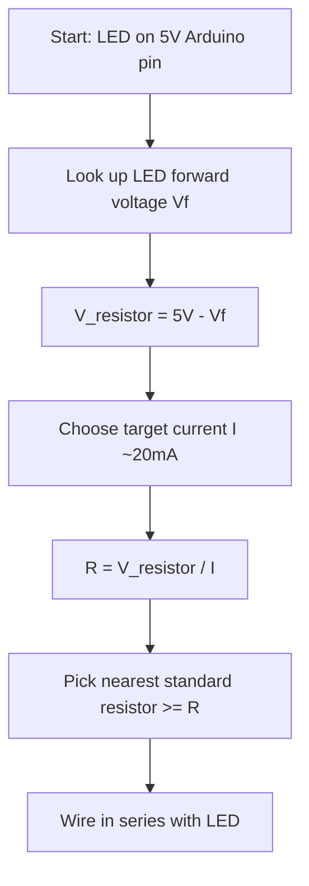

## For future agent
This note covers Episode 3 of Jeremy Blum's Arduino Tutorial Series — the "EE basics" detour. It is the theory backbone for every later hardware episode. Topics: Ohm's law (V=IR), power formula, calculating current-limiting resistors for LEDs (including the LED's forward-voltage drop), pull-up vs pull-down resistors, voltage dividers, potentiometers, an introduction to analog inputs, voltage regulators (7805) with decoupling capacitors, and using a multimeter. These formulas are exam-grade and stable. Jeremy's LED example uses a **2 V LED drop** and **3 V remaining across the resistor**; verify part-specific forward voltages from datasheets. Confidence: high.

# Episode 03 — Electrical Engineering Basics

## Episode Overview

This episode is a deliberate **detour**. There is no new Arduino code; instead, Jeremy steps back to explain the electrical engineering that makes every circuit from here on work. This is the single most reused theoretical content in the module: every sensor, motor, and LED circuit later in the series leans on these five ideas.

1. **Ohm's law** — the relationship between voltage, current, and resistance that tells you how much current flows and how to size a resistor.
2. **Current-limiting resistors** — why you can never connect an LED directly to a power source, and how to compute the resistor value.
3. **Pull-up and pull-down resistors** — the formal reason Episode 2's button circuit needed a resistor; also the basis for voltage dividers.
4. **Voltage dividers and potentiometers** — turning resistances into voltages, the principle behind analog sensors.
5. **Voltage regulators** — taking a rough, higher input (like 9 V) and producing a clean 5 V for sensitive components (servos, Episode 5).

### Learning objectives
- State and apply Ohm's law ($V = IR$) and the power formula ($P = VI$).
- Compute a current-limiting resistor value for an LED given its forward voltage.
- Explain the difference between pull-up and pull-down resistors, and when each is used.
- Derive a voltage divider's output voltage.
- Describe how a potentiometer acts as a variable voltage divider.
- Know why a voltage regulator needs decoupling capacitors.
- Read voltage, current, and continuity with a multimeter.

---

## Core Concepts (ELI5)

### Ohm's law: the water-pipe model
Electrical circuits are easiest to understand as **water in pipes**:

- **Voltage (V, volts)** = water **pressure**. Higher pressure pushes harder.
- **Current (I, amperes)** = the **rate of water flow** (litres per second).
- **Resistance (R, ohms, Ω)** = how **narrow or clogged** the pipe is.

Ohm's law says these three are locked together:

$$V = I \times R \qquad\text{or}\qquad I = \frac{V}{R} \qquad\text{or}\qquad R = \frac{V}{I}$$

Push water through a narrow pipe (high resistance) and less flows. Increase the pressure (voltage) and more flows. That is it. Every circuit calculation in the series is a rearrangement of this one equation.

**Power** is the second formula you should memorise:

$$P = V \times I \qquad\text{(watts)}$$

Power tells you how much *energy per second* a component burns, which is how you know whether a resistor will get hot. (Parts lists specify power ratings like 250 mW.)

### Why LEDs need a current-limiting resistor
An LED is **not** a resistor. Once the voltage across it crosses a threshold (its **forward voltage**, typically ~1.8–2.2 V for a red LED, ~3.2 V for blue/white), it conducts almost freely. Left to itself, it will draw as much current as the supply can give, heat up, and die (or take the Arduino pin down with it). The **current-limiting resistor** in series limits that current to a safe value.

Jeremy's worked example (Arduino pin = 5 V, red LED forward voltage ≈ 2 V):

1. The LED "uses up" (drops) about 2 V to make light.
2. That leaves **3 V** to drop across the series resistor.
3. Choose a target LED current, say 20 mA = 0.020 A.
4. Apply Ohm's law for the resistor:

$$R = \frac{V}{I} = \frac{3\ \text{V}}{0.020\ \text{A}} = 150\ \Omega$$

Hence the **150 Ω** resistor used throughout the series. Blog readers asked "where do the other 2 volts go?"—the answer is that the LED converts that energy into **light** (and a little heat); the resistor drops the rest.

**Rule of thumb:** with 5 V and a standard 2 V LED, anything from ~150 Ω to ~330 Ω is safe; higher resistance = dimmer LED. If you cannot find 150 Ω, a larger value works (just dimmer), as Jeremy confirmed.

### Pull-up vs pull-down resistors
Episode 2 used a **pull-down**. The general rule:

- **Pull-down:** resistor from pin to **ground**. Pin rests LOW; pressing a button to **+5 V** makes it HIGH. (`pinMode(pin, INPUT)`.)
- **Pull-up:** resistor from pin to **+5 V**. Pin rests HIGH; pressing a button to **ground** makes it LOW. The Arduino Uno also has **built-in pull-ups** you can switch on with `pinMode(pin, INPUT_PULLUP)` — no external resistor needed (used in Ep10).

Both exist only to give a floating input a defined resting state. In the pull-down version, when the button is open the pin is dragged to 0 V through the "large" resistor; when pressed, 5 V "wins" because it arrives with no resistance in the way. Jeremy's own explanation: *"the 5V signal wins."*

### Voltage dividers
Put two resistors in series across a voltage and take the output from the junction between them. The output is a fraction of the input, set by the resistance ratio:

$$V_{out} = V_{in} \times \frac{R_2}{R_1 + R_2}$$

**Why it matters:** sensors almost never output a clean 0–5 V. They output a resistance (photoresistor, thermistor, potentiometer) or a tiny voltage. A voltage divider turns a *resistance change* into a *voltage change* the Arduino can read. This is the heart of Episode 4.

### Potentiometers: a knob as two resistors
A **potentiometer** ("pot") is a resistor with a sliding contact (a **wiper**). As you turn the knob, the wiper moves, so the two resistances either side of it change — one goes up as the other goes down. Wire the two ends across +5 V and ground and the wiper becomes a **variable voltage divider**: at one extreme the wiper is near +5 V, at the other near 0 V, and in between it gives any voltage in between. That is exactly why a pot makes a perfect analog "knob" for `analogRead()`. (A **rheostat** is a two-terminal variable resistor; a **potentiometer** is the three-terminal divider version.)

### Voltage regulators and decoupling capacitors
A **voltage regulator** takes a higher, possibly noisy input voltage and outputs a steady, lower one. The classic **7805** outputs a clean **5 V** from anything roughly 7–35 V input (the extra voltage is dissipated as heat). Jeremy uses one in Episode 5 to power servos from a 9 V battery without disturbing the Arduino's own 5 V rail.

Two capacitors are needed for stability: a **ceramic** capacitor on the input and an **electrolytic** capacitor on the output. These **decoupling capacitors** absorb fast voltage ripple and keep the regulator from oscillating. Blog reader Juzlam asked why they are needed—Jeremy's answer: the capacitors required are far too large to build into the silicon of the regulator itself. (Readers also noted you may add an input electrolytic too, depending on the circuit's ripple demands.)

### Multimeters
A multimeter measures **voltage** (across two points, in parallel), **current** (through a component, in series), and **continuity/resistance**. Jeremy's demo uses it to watch the analog voltage from a potentiometer change as he turns the knob and to verify a circuit's connections. Knowing which mode to use — and that current must be measured *in series* while voltage is measured *across* — prevents blown fuses and wrong readings.

---

## Code / Circuit Walkthrough

There is minimal code in this episode. The representative circuit is the **potentiometer voltage divider feeding an analog pin**, previewed here and fully used in Episode 4:

```
        +5V
         |
        [ POT ]  <-- three terminals
         |   \
   (wiper)----+--------> A0  (analog input)
         |
        GND
```

```
   +5V ---[R1]---+---[R2]--- GND
                  |
                  +---> A0   (Vout = 5V * R2/(R1+R2))
```

And the LED current-limiting circuit:

```
   Arduino pin ---[150 ohm]---|>|--- GND
                                LED
   (pin HIGH = 5V; ~2V drops across LED; 3V across resistor)
```

Mermaid decision flow for "how big should my LED resistor be?":



### The voltage-divider / regulator summary table

| Component | Role | Formula / value |
|-----------|------|-----------------|
| Current-limiting resistor | Protect LED | $R=(V_{supply}-V_f)/I$ |
| Pull-down | Define input LOW at rest | pin→GND via 10 kΩ |
| Pull-up | Define input HIGH at rest | pin→+5 V via 10 kΩ (or `INPUT_PULLUP`) |
| Voltage divider | Scale voltage down | $V_{out}=V_{in}\,R_2/(R_1{+}R_2)$ |
| Potentiometer | Variable divider ("knob") | wiper voltage 0–5 V |
| 7805 regulator | Clean 5 V from higher Vin | needs ceramic in + electrolytic out |

---

## Key Functions Reference

This episode is hardware theory, so "functions" here are the calculation tools you will reuse:

| Tool | Formula | Use |
|------|---------|-----|
| Ohm's law | $V = I R$ | Solve for any of V, I, R |
| Current for LED | $I = (V_{supply}-V_f)/R$ | Check LED current is ≤ ~20 mA |
| Resistor for LED | $R = (V_{supply}-V_f)/I$ | Size the series resistor |
| Power | $P = V I$ | Check resistor wattage / heat |
| Voltage divider | $V_{out}=V_{in}\,R_2/(R_1{+}R_2)$ | Scale a sensor voltage |

---

## Common Pitfalls / Gotchas

1. **Connecting an LED with no series resistor.** The single most common way beginners destroy LEDs and pins. Always compute and insert a resistor.
2. **Forgetting the LED's forward-voltage drop.** Computing $R=5/0.02=250\ \Omega$ (using the full 5 V) undervalues the resistor slightly; the correct starting point is $5-2=3\ \text{V}$, giving 150 Ω. The LED "eats" its forward voltage first.
3. **Confusing pull-up and pull-down logic.** Pull-down rests LOW (button to +5 V); pull-up rests HIGH (button to GND, or `INPUT_PULLUP`). Reversing them inverts your button.
4. **Using a voltage divider to power a load.** Dividers are for **signals**, not for driving current-hungry loads; the output voltage sags as soon as you draw current. Use a regulator instead.
5. **Regulator without decoupling capacitors.** It may oscillate or run unstable; always add the in/out capacitors.
6. **Measuring current in parallel.** A multimeter measures current **in series**; connecting it across a supply in current mode shorts it and blows the fuse.
7. **Regulator heat.** The 7805 burns the difference $(V_{in}-5\text{V})\times I$ as heat; a 9 V→5 V drop at high current gets hot and may need a heatsink.
8. **Polarised electrolytic capacitors.** Electrolytics have + and −; reversing them can pop. (Jeremy warns about this for the Ep10 10 µF cap.)

---

## Practice Exercises

1. **Compute a resistor for a blue LED.** Assume $V_f = 3.2$ V and target 15 mA. Find $R$. Then check the power $P = I^2R$ to confirm a 250 mW resistor is fine.
2. **Design a divider.** Pick $R_1 = R_2 = 10\ \text{k}\Omega$ across 5 V. What is $V_{out}$? Now make $R_2 = 20\ \text{k}\Omega$; recompute. This is exactly how a sensor's resistance becomes a voltage.
3. **Pull-up conversion.** Redraw the Episode 2 pull-down button as a pull-up (resistor to +5 V, button to GND) and write the `if` condition that turns the LED on when pressed. Note how the logic inverts.
4. **Pot extremes.** For a 10 kΩ pot wired across 5 V, what wiper voltage do you read at each extreme and at the midpoint? Explain using the divider formula.
5. **Regulator budget.** From a 9 V battery through a 7805 at 250 mA, how much power is wasted as heat? Would you need a heatsink? Justify with $P=(V_{in}-V_{out})I$.

---

## Cross-Links

- [[01-Areas/Engineering/arduino-microcontrollers/INDEX|Arduino Module Index]]
- [[01-Areas/Engineering/arduino-microcontrollers/ep02-buttons-pwm-functions|Episode 02 — Buttons & PWM]] — the pull-down resistor in practice.
- [[01-Areas/Engineering/arduino-microcontrollers/ep04-analog-inputs|Episode 04 — Analog Inputs]] — applies dividers and pots with `analogRead()`.
- [[01-Areas/Engineering/arduino-microcontrollers/ep05-motors-transistors|Episode 05 — Motors & Transistors]] — uses the 7805 regulator on a separate 5 V rail.
- [[01-Areas/Engineering/BEE/INDEX|Basic Electrical Engineering]] — the full coursework treatment of DC circuits, Thevenin, and AC.
- [[01-Areas/Engineering/BEE/thevenin-vth-rth-worked-examples|BEE Thevenin worked examples]] — voltage-divider thinking formalised as Thevenin's theorem.
