## For future agent
This note covers Episode 4 of Jeremy Blum's Arduino Tutorial Series — analog inputs. Key: `analogRead()` returns a **10-bit** value (0–1023) proportional to 0–5 V on pins A0–A5; the conversion factor is 5 V/1024 ≈ 4.883 mV per step. Circuits: a photoresistor voltage divider (automatic night light) and a Sharp GP2D/GP2Y-style IR distance sensor. Program concepts: reading the ADC, printing raw values to Serial, threshold detection, and `map()` to rescale. Jeremy notes the 150 Ω resistor can be substituted with a larger value (dimmer LED). Confidence: high; note that **sensor orientation can invert the reading** (commenters Eko/rbell3485 hit this) — flagged as a gotcha.

# Episode 04 — Analog Inputs

## Episode Overview

Everything so far was binary: a pin was on or off, a button was pressed or not. The real world is not binary. Light level, temperature, distance, and sound all come in *degrees*. Episode 4 introduces the Arduino's **Analog-to-Digital Converter (ADC)**, which turns a continuously varying voltage (0–5 V) into a number the program can reason about (0–1023).

This unlocks sensor-driven projects. You learn to:

1. Read an analog voltage with `analogRead()` and interpret the raw number.
2. Build a **voltage divider** sensor (from Episode 3 theory) with a **photoresistor** that changes resistance with light.
3. Use the **Sharp IR distance sensor** to measure proximity.
4. Convert raw readings into useful units with **`map()`**.
5. Make decisions with **thresholds** — the automatic emergency light that turns on when the room gets dark.

### Learning objectives
- Explain the difference between analog and digital signals.
- Use `analogRead()` on A0–A5 and convert its 0–1023 result into voltage.
- Build a voltage divider with a photoresistor and predict which way the reading moves as light changes.
- Use `map()` to rescale a range (e.g. 0–1023 → 0–255 PWM, or distance → angle in Ep5).
- Implement threshold detection (dark → turn on light).
- Print readings to the Serial Monitor for debugging.

---

## Core Concepts (ELI5)

### Analog vs digital
A **digital** signal has only two values: on/off, HIGH/LOW, 1/0. An **analog** signal can take *any* value in a range: a dimmer switch, a volume knob, a voice waveform. The Arduino is a digital computer, so to read analog it uses an **ADC** that "samples" the continuous voltage many times a second and reports where it sits between 0 and 5 V.

**Analogy:** a digital sensor is a light switch; an analog sensor is a dimmer slider. The ADC is a very fast reader that says "right now the slider is 62% of the way up."

### The 10-bit ADC: 0–1023
The Uno's ADC is **10-bit**, meaning it splits the 0–5 V range into $2^{10} = 1024$ steps. So `analogRead()` returns an integer from **0 (0 V) to 1023 (5 V)**. Each step is:

$$\frac{5.0\ \text{V}}{1024} \approx 4.883\ \text{mV}$$

To convert a reading back to volts: $V = \text{reading} \times 5.0 / 1023$ (or /1024; both are close enough in practice). This number-to-volts conversion appeared in blog comments (the TMP36 sensor example).

### Voltage-divider sensing, again
From Episode 3: two resistors in series make a divider. Replace one with a **variable** resistor and the output voltage tracks whatever the sensor measures. A **photoresistor (LDR)** is a resistor whose resistance *falls* as light increases. Put it in a divider with a fixed resistor and the wiper voltage now depends on the light level:

- **Bright** → LDR resistance low → if the LDR is the top resistor, the output voltage goes **up**.
- **Dark** → LDR resistance high → output voltage goes **down**.

Which direction the reading moves depends on **which side of the divider the sensor sits on**. That is why some makers find their circuit "backwards" (see gotchas).

### Thresholds: turning a number into a decision
A sensor gives a number; your program gives it *meaning*. `if (analogRead(sensorPin) < 200)` is the whole idea of the emergency light: when the light reading drops below a threshold, the room is dark, so turn the LED on. Choosing the threshold is a calibration step — watch the Serial Monitor, note readings in light and dark, and pick a value between.

### map()
`map()` linearly rescales one integer range to another:

```cpp
map(value, fromLow, fromHigh, toLow, toHigh)
```

`map(analogRead(0), 0, 1023, 0, 255)` takes a raw 0–1023 sensor reading and produces a 0–255 value suitable for `analogWrite()` (PWM). It is pure arithmetic — a straight-line fit — and is used again in Episode 5 to turn distance into a servo angle. Note `map()` does **not** clamp: out-of-range inputs can produce out-of-range outputs, so `constrain()` is often added afterwards (Jeremy does this in Ep5/Ep9).

---

## Code Walkthrough

### Program 1 — read and print a photoresistor

```cpp
// Episode 4 - read_light
// Print the raw analog value from a photoresistor divider

int sensorPin = 0;     // analog input A0
int sensorValue = 0;   // will hold the ADC reading

void setup() {
  Serial.begin(9600);  // open the serial link to the computer
}

void loop() {
  sensorValue = analogRead(sensorPin);  // 0..1023
  Serial.println(sensorValue);          // print it, one per line
  delay(100);                           // 10 readings per second
}
```

**What is happening.** `analogRead(0)` samples the divider's midpoint. `Serial.println()` sends the number to the Serial Monitor (open it with the magnifying-glass icon; set baud to 9600). Cover the LDR and watch the number move; note the light and dark values — those become your threshold.

### Program 2 — automatic emergency/night light

```cpp
// Episode 4 - emergency_light
// LED turns ON when the room is dark

int sensorPin = 0;        // photoresistor on A0
int ledPin = 9;           // LED on a PWM pin (or 13)
int threshold = 200;      // calibrated "dark" boundary

void setup() {
  pinMode(ledPin, OUTPUT);
  Serial.begin(9600);
}

void loop() {
  int lightLevel = analogRead(sensorPin);

  if (lightLevel < threshold) {   // dark?
    digitalWrite(ledPin, HIGH);   // turn the light on
  } else {
    digitalWrite(ledPin, LOW);    // bright enough, keep off
  }

  Serial.println(lightLevel);     // watch calibration live
  delay(100);
}
```

**Calibrate before trusting it.** Run with the Serial Monitor open. Read the value with the light on and the value when you cover the sensor. Set `threshold` between them — closer to the dark value makes the light trigger earlier.

### Program 3 — brightness follows light (using map)

```cpp
int sensorPin = 0;
int ledPin = 9;

void setup() {
  pinMode(ledPin, OUTPUT);
}

void loop() {
  int lightLevel = analogRead(sensorPin);          // 0..1023
  int brightness = map(lightLevel, 0, 1023, 0, 255); // scale to PWM
  analogWrite(ledPin, brightness);                 // dim accordingly
  delay(50);
}
```

Here the LED dims smoothly instead of snapping on — the analog-to-PWM bridge you will reuse constantly.

### The Sharp IR distance sensor
The Sharp IR sensor outputs an **analog voltage** that depends on distance (roughly inversely). Instead of a divided resistance, you simply connect its signal pin to A0 and `analogRead()` it:

```
   Sharp IR:  V+ ---> +5V
              GND --> GND
              OUT --> A0
```

Because the relationship is non-linear (closer objects give a larger change, and the output is actually an inverse function of distance), precise distance needs a look-up or the datasheet's curve — but for *detecting* presence/movement (a threshold), the raw reading is enough. This same sensor returns in Ep10's mood-light project.

### Logic flowchart

```mermaid
flowchart TD
    A[loop&#40;&#41;] --> B[lightLevel = analogRead&#40;A0&#41;]
    B --> C{lightLevel < threshold?}
    C -- Yes, dark --> D[LED ON]
    C -- No, bright --> E[LED OFF]
    D --> F[print lightLevel]
    E --> F
    F --> A
```



---

## Key Functions Reference

| Function | Syntax | What it does | Example |
|----------|--------|--------------|---------|
| `analogRead` | `analogRead(pin)` | Reads ADC on A0–A5, returns 0–1023. | `int v = analogRead(A0);` |
| `map` | `map(v, fL,fH, tL,tH)` | Linear rescale of integer range. | `map(v,0,1023,0,255)` |
| `constrain` | `constrain(v, lo, hi)` | Clamp a value into a range. | `constrain(a,0,180)` |
| `Serial.begin` | `Serial.begin(baud)` | Opens serial link (usually 9600). | `Serial.begin(9600);` |
| `Serial.println` | `Serial.println(x)` | Prints a value + newline. | `Serial.println(v);` |

**ADC facts:** 10-bit, 0–1023, 5 V/1024 ≈ 4.883 mV per step; `analogRead` takes ~100 µs, so ~10,000 reads/second max.

---

## Common Pitfalls / Gotchas

1. **"My night light works backwards."** The most reported issue (commenters Eko, rbell3485). If the LDR is on the wrong side of the divider, more light makes the ADC value *rise* instead of fall (or vice versa). Fix either by swapping the sensor and fixed resistor positions **or** by reversing the `<`/`>` in the `if`. Understand *why* rather than blindly swapping.
2. **Forgetting `Serial.begin(9600)`** before printing → empty Serial Monitor. Also match the Monitor's baud rate to the `begin` value.
3. **Watching garbage/`-38` in the Monitor.** Usually a line-ending/baud mismatch or leftover bytes (more relevant in Ep6). Set the Monitor's line-ending to "No line ending" when printing raw numbers.
4. **Assuming `analogRead` returns volts.** It returns a count (0–1023). Convert: $V = \text{count}\times5/1023$.
5. **`map()` producing out-of-range output.** `map()` does not clamp. If a sensor glitches above 1023 or below 0, add `constrain()`.
6. **Using a digital pin for `analogRead`.** Analog reads only work on A0–A5 (which are labelled separately).
7. **Setting a threshold without calibrating.** Values differ with lighting, supply voltage, and sensor. Always read live values before fixing the threshold.
8. **Sensor interference when combining sensors.** Commenter marcomaroso found an LDR plus other sensors gave junk readings — shared supply noise and inadequate settling; read sensors separately with small delays.

---

## Practice Exercises

1. **Voltage conversion.** Using the Serial Monitor, note the light and dark readings of your LDR. Convert each to volts with $V=\text{count}\times5/1023$.
2. **Hysteresis light.** Improve the emergency light so it does not flicker at the threshold: turn on below 180, off only above 220. This "two-threshold" trick is used in real thermostats.
3. **Inverted brightness.** Make the LED *brighter* as the room gets *darker* (night-light dimmer) using `map()`. Decide whether you need to invert the range.
4. **IR presence alarm.** Wire the Sharp IR sensor and make an LED light when an object comes closer than a threshold. Log raw values to calibrate.
5. **Two sensors.** Read two analog pins and print both, separated by a comma, preparing for the parse-and-visualise work in Episode 6.

---

## Cross-Links

- [[01-Areas/Engineering/arduino-microcontrollers/INDEX|Arduino Module Index]]
- [[01-Areas/Engineering/arduino-microcontrollers/ep03-electrical-basics|Episode 03 — EE Basics]] — the voltage-divider theory underlying every analog sensor.
- [[01-Areas/Engineering/arduino-microcontrollers/ep05-motors-transistors|Episode 05 — Motors & Transistors]] — `map()` turns distance into a servo angle.
- [[01-Areas/Engineering/arduino-microcontrollers/ep06-serial-processing|Episode 06 — Serial & Processing]] — visualising these analog readings on screen.
- [[01-Areas/Engineering/arduino-microcontrollers/ep10-interrupts-debouncing|Episode 10 — Interrupts & Hardware Debouncing]] — the Sharp IR sensor returns there.
- [[01-Areas/Engineering/BEE/INDEX|Basic Electrical Engineering]] — divider theory formalised.
