## For future agent
This note covers Episode 5 of Jeremy Blum's Arduino Tutorial Series — motors and transistors. Two builds: (1) a DC motor on a 9 V battery switched by an **NPN transistor** with a **1 kΩ base resistor**, a **1N4004 flyback diode**, and PWM speed control; (2) a **servo** powered from a separate regulated 5 V rail via a **7805**, controlled with the `Servo` library and `map()` from an analog sensor. Also introduces the **H-bridge** for reversing motor direction. Safety-critical gotchas: never drive a motor directly from an Arduino pin; the flyback diode is not optional; common-ground the rails. Jeremy notes an oscillating/overheating transistor problem in the book's forum (base resistor value and motor current). Confidence: high, part tolerances flagged.

# Episode 05 — Motors and Transistors

## Episode Overview

An LED draws about 20 mA. A motor draws **hundreds of milliamps to several amps** — far more than an Arduino pin can supply (≈40 mA absolute max). If you connect a motor straight to a pin, you will destroy the pin. Episode 5 teaches the standard solution: use the Arduino pin to control a **transistor**, and let the transistor switch the motor's own, separate power supply. Then it covers a second, easier motor type — the **servo** — and how to give it a clean, independent 5 V supply.

You learn three big ideas:

1. **A transistor is an electrically controlled switch.** A tiny current into the base controls a large current through the collector–emitter path. This is how a 5 mA Arduino pin controls a 1 A motor.
2. **Flyback protection.** Motors are inductors; when they switch off, they kick back a voltage spike that can fry a transistor. A diode across the motor gives that spike a safe path.
3. **Power discipline.** Motors and servos get their own supply; only the *control* signal comes from the Arduino, and the grounds must be tied together.

### Learning objectives
- Explain why an Arduino pin cannot drive a motor directly.
- Wire an NPN transistor as a low-side switch with a base resistor.
- Explain the purpose of the flyback diode.
- Control DC motor speed with PWM.
- Power a servo from a separate regulated 5 V rail (7805) and control it with `Servo.write()`.
- Use `map()` to convert sensor readings into servo angles.
- Describe at a high level how an H-bridge reverses a DC motor.

---

## Core Concepts (ELI5)

### Why a pin cannot drive a motor
The ATmega can source roughly 40 mA per pin (20 mA comfortable). A small DC motor wants 100–1000+ mA and has a low-resistance coil. Connecting it directly is like wiring a fire hose to a drinking straw — the straw bursts. The pin is the *decision-maker*, not the *power source*.

### The transistor as an electronic switch
An **NPN transistor** has three legs: **Base (B), Collector (C), Emitter (E)**. Think of the collector–emitter path as the switch contacts and the base as the hand that flips it — except the "hand" is a small current. A modest current into the base (limited by a resistor) allows a much larger current to flow from collector to emitter.

- **Base resistor (1 kΩ):** sets the base current to a safe, sufficient level. Too small → excess current into the base; too large → transistor never fully turns on (it gets hot, as one book reader found).
- **Low-side switch:** the motor sits between +9 V and the collector; the emitter goes to ground. Turning the transistor on connects the motor's bottom end to ground and current flows.

**Analogy:** a transistor is a relay with no moving parts — a small control signal opens a gate for a big flow. Actually, it is better than a relay: it can open partially, which is why it can also do PWM.

### The flyback diode (why it is mandatory)
A motor is an **inductor**: a coil that stores energy in a magnetic field. When you cut the current, the collapsing field generates a large reverse voltage spike ("back-EMF" / inductive kick) that can be hundreds of volts. That spike would puncture the transistor. The **flyback diode** (1N4004) is placed **across the motor in reverse** (cathode to +V), so during normal operation it does nothing, but when the spike appears it provides a safe circulating path and clamps the voltage. Skipping this diode is the classic way to kill transistors.

### PWM speed control
Because the transistor can switch fast, feeding the base a PWM signal from a `~` pin makes the motor's *average* voltage — and therefore its speed — vary. `analogWrite(motorPin, 0..255)` ramps a motor smoothly. Note the transistor is driven through the same pin, so this is exactly the Episode 2 PWM idea applied to a power device.

### Servo motors
A **servo** is a geared DC motor with built-in feedback that holds a commanded *angle* (0–180° for the standard hobby servo) rather than spinning freely. You do not drive a servo with raw PWM; you use the **Servo library**, which generates the correct pulse train on any digital pin:

```cpp
#include <Servo.h>
Servo myServo;
myServo.attach(9);      // signal wire on pin 9
myServo.write(90);      // go to 90 degrees
```

Servos draw current spikes when moving, which is exactly why Jeremy powers them from a **separate regulated 5 V rail** instead of the Arduino's 5 V output, so the logic supply stays clean.

### The 7805 rail
The 9 V battery feeds a **7805** regulator, whose output is a clean 5 V for the servo. The Arduino and the servo share a **common ground** — this is essential, or the control signal has no reference. Two decoupling capacitors (from Episode 3) keep the rail stable.

### H-bridge (mentioned)
An **H-bridge** uses four switches (transistors) to reverse the polarity across a motor, giving **forward and reverse** plus brake/coast. The L293D/L298N are the common chips. This episode only introduces the concept; the four-transistor topology is the "H". Direction is to DC motors what angle is to servos.

---

## Code Walkthrough

### Program 1 — DC motor ramps up and down (PWM + transistor)

```cpp
// Episode 5 - DC motor speed ramp
int motorPin = 9;   // PWM pin -> transistor base (through 1k)

void setup() {
  // analogWrite handles everything; no pinMode needed for PWM,
  // but setting it is harmless:
  pinMode(motorPin, OUTPUT);
}

void loop() {
  // Ramp from off to full speed
  for (int i = 0; i <= 255; i += 5) {
    analogWrite(motorPin, i);
    delay(30);
  }
  delay(500);              // hold at full speed briefly
  // Ramp back down
  for (int i = 255; i >= 0; i -= 5) {
    analogWrite(motorPin, i);
    delay(30);
  }
  delay(500);
}
```

**What is happening.** The `for` loops sweep the PWM duty from 0 to 255 and back, so the motor accelerates and decelerates smoothly. `delay(30)` inside the loop sets the ramp time. The transistor does the heavy lifting; the Arduino only sets the base drive.

### Program 2 — servo controlled by distance (map)

```cpp
#include <Servo.h>

Servo myServo;

int servoPin = 9;
int distPin = 0;    // Sharp IR analog output on A0
int dist = 0;
int angle = 0;

void setup() {
  myServo.attach(servoPin);
  Serial.begin(9600);
}

void loop() {
  dist = analogRead(distPin);                    // 0..1023
  angle = map(dist, 0, 1023, 0, 180);            // to servo degrees
  angle = constrain(angle, 0, 180);              // safety clamp
  myServo.write(angle);                          // command the servo
  Serial.println(angle);
  delay(50);
}
```

**Reasoning.** `map()` converts the sensor's numeric range into the servo's 0–180° range; `constrain()` guards against out-of-range glitches (a habit Jeremy repeats in Ep9/Ep10). As you move your hand nearer/farther from the IR sensor, the servo sweeps. This is a complete "sense → compute → actuate" loop — the template for a robot arm.

### Wiring (DC motor) at a glance

```
   +9V ---[ MOTOR ]---+-----------------------+
                      |                       |
                     (C)                   [DIODE]  (1N4004, reverse)
        Base drive    |                       |
  pin9 --[1k]--(B)  [NPN]                    (A)
                      |                       |
   GND ---------------(E)---------------------+
```
(Recall: diode across the motor, cathode to +9 V; emitter to ground; base through 1 kΩ to the pin.)

### Servo rail at a glance

```
  9V battery ----[7805]---- +5V rail ---> Servo V+
                        |---- GND ----------> Servo GND
  Arduino GND ----------------------------> common GND (tie together!)
  Arduino pin9 ---------------------------> Servo signal
```

### Logic flowchart (servo)

```mermaid
flowchart TD
    A[loop&#40;&#41;] --> B[dist = analogRead&#40;A0&#41;]
    B --> C[angle = map&#40;dist, 0,1023, 0,180&#41;]
    C --> D[angle = constrain&#40;angle, 0,180&#41;]
    D --> E[myServo.write&#40;angle&#41;]
    E --> A
```



---

## Key Functions Reference

| Function | Syntax | What it does | Example |
|----------|--------|--------------|---------|
| `analogWrite` | `analogWrite(pin, 0..255)` | PWM (motor speed). | `analogWrite(9, 200);` |
| `Servo` | `#include <Servo.h>` | Adds servo control. | `Servo myServo;` |
| `attach` | `myServo.attach(pin)` | Binds the servo to a pin. | `myServo.attach(9);` |
| `write` | `myServo.write(deg)` | Command angle 0–180. | `myServo.write(90);` |
| `map` | `map(v,0,1023,0,180)` | Rescale sensor → angle. | `angle = map(d,0,1023,0,180);` |
| `constrain` | `constrain(v,0,180)` | Clamp into range. | `angle = constrain(a,0,180);` |

**Key components:** BC547 (NPN), 1 kΩ base resistor, 1N4004 flyback diode, 7805 regulator, 22 µF decoupling caps, 150 Ω LED resistors, 180° hobby servo.

---

## Common Pitfalls / Gotchas

1. **Driving a motor directly from a pin.** Guaranteed pin/board damage. Always use a transistor or driver.
2. **Omitting the flyback diode.** The inductive kick fries the transistor. Diode across the motor, reversed.
3. **Missing common ground.** If the servo/motor supply and the Arduino do not share ground, the control signal is meaningless and nothing works.
4. **Wrong base resistor → overheating transistor.** Too large and it never saturates (reads high V across it, gets hot); too small and the base current is excessive. A book reader burned transistors until the base drive was right.
5. **Expecting a servo to spin continuously.** Standard servos hold an *angle* (0–180°); they are not continuous-rotation motors. (Some servos can be modified for continuous rotation, but that is out of scope.)
6. **Powering a servo from the Arduino 5 V pin.** Current spikes brown out the board and reset it. Use a separate regulated rail (as Jeremy does).
7. **Assuming PWM frequency is silent.** Motors/servos can hum at some duty cycles; that is normal.
8. **`map()` without `constrain()`.** Glitchy sensors can command angles outside 0–180°, making the servo strain. Clamp.
9. **Forgetting the servo needs its own supply only for *power*, not signal.** Signal still comes from the Arduino pin; only V+/GND are external (with common ground).

---

## Practice Exercises

1. **Constant-speed motor.** Replace the ramp with a fixed `analogWrite(9, 128)` and measure/observe half-speed. Then try 64 and 200.
2. **Pot → servo.** Reuse the Episode 4 potentiometer. Map the pot's 0–1023 to 0–180 and drive the servo with the knob. This is the classic "manual servo control."
3. **Ramp with a pot.** Combine ideas: pot sets the *top* speed of a ramp-up/ramp-down cycle.
4. **Verify the diode.** With the diode removed (briefly, small motor, at your own risk), observe erratic switching — then reinstall it and explain the difference.
5. **Map maths.** Choose a sensor range you actually measured (e.g. 300–800) and map to 0–180 with `constrain`. Why is mapping the true range better than 0–1023?

---

## Cross-Links

- [[01-Areas/Engineering/arduino-microcontrollers/INDEX|Arduino Module Index]]
- [[01-Areas/Engineering/arduino-microcontrollers/ep03-electrical-basics|Episode 03 — EE Basics]] — the 7805 regulator and decoupling capacitors used here.
- [[01-Areas/Engineering/arduino-microcontrollers/ep04-analog-inputs|Episode 04 — Analog Inputs]] — the Sharp IR sensor whose reading becomes a servo angle.
- [[01-Areas/Engineering/arduino-microcontrollers/ep09-wireless-communication|Episode 09 — Wireless]] — sends the pot value to the servo over radio.
- [[01-Areas/Engineering/BEE/INDEX|Basic Electrical Engineering]] — DC machines and induction motors (the coursework view of motors).
- [[01-Areas/Engineering/nexus-robotics/nexus-c-embedded-drills|Nexus Robotics — Embedded C]] — PID (T7) is how you *control* a motor more precisely than `map()`.
