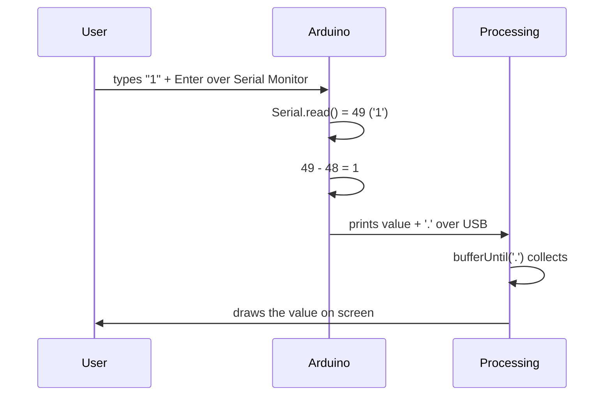

## For future agent
This note covers Episode 6 of Jeremy Blum's Arduino Tutorial Series — serial communication and Processing. Core Arduino-side concepts: `Serial.begin(baud)`, `Serial.print/println`, `Serial.available()`, `Serial.read()`, the **ASCII** encoding of characters, and converting an ASCII digit to an integer by subtracting `'0'`. Important version caveat: **`Serial.flush()` changed meaning in Arduino 1.0** — it now waits for outgoing data, so to clear the *receive* buffer you use `while (Serial.available() > 0) Serial.read();` (Jeremy's own correction). Computer-side: the **Processing** environment visualises Arduino data. Commenters hit two recurring issues: seeing `49 10` or `-38` instead of `1` (a line-ending/ASCII artefact) — flagged as gotchas. Confidence: high with version notes.

# Episode 06 — Serial Communication and Processing

## Episode Overview

Episodes 1–5 ran entirely on the board. Episode 6 is the first of four episodes about **communication** — getting data out of the Arduino, and later between Arduinos and devices. Serial is the simplest and most-used channel: the same USB cable you upload over can also carry live data both ways.

Two halves:

1. **Arduino side — UART serial.** Send numbers and text to the computer's **Serial Monitor**, and read characters the human types back. This is your primary debugging tool forever.
2. **Computer side — Processing.** A Java-based creative-coding environment that can read the serial port and *draw* the data — graphs, gauges, animations. It is the Arduino's visual companion.

The one concept that trips up nearly everyone: **characters vs numbers**. When you type `1`, the Arduino receives the *character* `'1'`, whose ASCII code is **49**, not the value 1. Episode 6 teaches the fix.

### Learning objectives
- Open a serial connection at the right baud rate.
- Print values to the Serial Monitor and read typed input back.
- Explain the ASCII table and why `'1'` ≠ 1.
- Convert an ASCII digit to an integer with `char - '0'`.
- Use `Serial.available()` to wait for and count incoming bytes.
- Clear the input buffer correctly (post-1.0).
- Write a basic Processing sketch that reads and displays Arduino data.

---

## Core Concepts (ELI5)

### Serial is a two-lane road
Serial communication sends bits one after another (hence "serial") down a pair of wires — one lane from Arduino to computer (TX), one back (RX). Over USB these lanes are virtual, but the model is the same. Both ends must agree on the **baud rate** (symbols per second). The series uses **9600**. If the two ends disagree, you get garbage — the digital equivalent of two people talking at different speeds.

**Analogy:** serial is a conversation down a tin-can telephone; baud rate is how fast you speak. Mismatch it and you hear nonsense.

### Bytes, characters, and ASCII
Everything on the wire is a **byte** (0–255). To represent text, computers use the **ASCII** table, which assigns a number to each character:

| Character | ASCII code |
|-----------|-----------|
| `'0'` | 48 |
| `'1'` | 49 |
| `'2'` | 50 |
| … | … |
| `'\n'` (newline) | 10 |
| `'\r'` (carriage return) | 13 |

So when the human types `1` and hits enter in the Serial Monitor, the Arduino reads the byte **49**, then possibly **10** (newline) and/or **13**. That is exactly why commenters saw "49 10" instead of "1" — the Arduino was faithfully printing what it *received*.

### The subtract-'0' trick
To turn the character `'1'` into the integer 1, subtract the character `'0'`:

```cpp
int val = Serial.read() - '0';   // '1'(49) - '0'(48) = 1
```

Because `'0'` is 48 and `'1'` is 49, the difference is 1. The same works for any single digit (`'7' - '0' = 7`). This is the standard idiom for parsing single-digit commands. (For multi-digit numbers you accumulate digits and multiply by 10 — beyond this episode but worth knowing.)

### available(), read(), and waiting
`Serial.available()` returns **how many bytes are waiting** in the receive buffer. `Serial.read()` pulls **one** byte off. So:

```cpp
while (Serial.available() == 0);   // busy-wait: do nothing until a byte arrives
int val = Serial.read() - '0';     // then read it
```

The empty `while` is a busy-wait — the program spins until you send something. It works, but blocks everything else (a motif revisited with interrupts in Ep10).

### Flushing the buffer (the Arduino 1.0 change)
If you only read one byte but the human typed several (or the line ending left extras), those leftovers will be read as garbage next time. Jeremy's original video used `Serial.flush()` to clear the input buffer — but **Arduino 1.0 changed `Serial.flush()`** to mean "wait until outgoing data is sent." The correct modern way to dump the *input* buffer is:

```cpp
while (Serial.available() > 0) Serial.read();  // discard everything pending
```

This fix is on his blog as an edit, and commenters (Jenny, Nicholai) discovered it live.

### Processing
**Processing** is a free, Java-based IDE for visual art and data. Its `Serial` library can open the same COM port your Arduino prints to. The Processing sketch reads a string, parses it, and draws text/shapes. Jeremy's episode prints Arduino data and draws it as a large on-screen readout. Processing uses `port.bufferUntil('.')` to gather characters until a delimiter, then `readStringUntil('.')` and `substring()` to trim it. The Arduino adds the delimiter; Processing splits on it.

---

## Code Walkthrough

### Program 1 — send a character, echo it back

```cpp
// Episode 6 - Serial echo
// Type a character; the Arduino prints it back as a number.

void setup() {
  Serial.begin(9600);
}

void loop() {
  while (Serial.available() == 0);   // wait for input
  int val = Serial.read() - '0';     // ASCII digit -> integer
  Serial.println(val);               // print the value
}
```

**Behaviour.** Type `1` and press enter → the Monitor shows `1` (or `49 10` if you forget the subtraction and leave a line ending). This tiny program is the Rosetta Stone of serial data.

### Program 2 — control an LED from the keyboard

```cpp
// Episode 6 - Keyboard-controlled LED
int ledPin = 13;

void setup() {
  Serial.begin(9600);
  pinMode(ledPin, OUTPUT);
}

void loop() {
  while (Serial.available() == 0);
  int val = Serial.read() - '0';

  if (val == 1) {
    Serial.println("LED is on");
    digitalWrite(ledPin, HIGH);
  } else if (val == 0) {
    Serial.println("LED is off");
    digitalWrite(ledPin, LOW);
  } else {
    Serial.println("Invalid!");
  }

  // Clean out any leftover bytes (line ending, extra chars)
  while (Serial.available() > 0) Serial.read();
}
```

**Why the final while loop.** Without it, the newline/CR that Windows sends after your `1` remains in the buffer and is read next pass as `-38` (10 or 13 minus 48), triggering "Invalid!". Flushing fixes it. Commenter Jenny's "Invalid! in between everything" is exactly this bug. Setting the Monitor's line-ending to **"No line ending"** also avoids it.

### Program 3 — Processing visualisation (computer side)

```java
// Processing sketch - read Arduino serial and display it
import processing.serial.*;

Serial port;
String data = "";
PFont font;

void setup() {
  size(400, 400);
  port = new Serial(this, "COM3", 9600);  // match your port + baud
  port.bufferUntil('.');                  // read until '.' delimiter
  font = loadFont("AgencyFB-Bold-200.vlw");
  textFont(font, 200);
}

void draw() {
  background(0);
  fill(255);
  text(data, 10, 300);    // draw the received string large
}

void serialEvent(Serial port) {
  data = port.readStringUntil('.');
  data = data.substring(0, data.length() - 1);  // drop the '.'
}
```

**Reasoning.** `new Serial(this, "COM3", 9600)` opens the port (list available ports with `Serial.list()`). `bufferUntil('.')` accumulates until the Arduino prints a period. `serialEvent()` fires when a full message arrives; it strips the delimiter and stores the string, which `draw()` renders each frame. Matching the Arduino's output format (add a `.` at the end of each line) is what makes the two programs cooperate.

### Communication flow



---

## Key Functions Reference

| Function | Syntax | What it does | Example |
|----------|--------|--------------|---------|
| `Serial.begin` | `Serial.begin(9600)` | Open serial at a baud rate. | `Serial.begin(9600);` |
| `Serial.print` | `Serial.print(x)` | Print without newline. | `Serial.print(v);` |
| `Serial.println` | `Serial.println(x)` | Print with newline. | `Serial.println(v);` |
| `Serial.available` | `Serial.available()` | Count of bytes waiting. | `while(Serial.available()==0);` |
| `Serial.read` | `Serial.read()` | Read one byte (or -1 if none). | `int c = Serial.read();` |
| `Serial.flush` | *(changed in 1.0)* | 1.0+: waits for TX to finish. | *use `while(Serial.available()>0) Serial.read();` to clear RX* |
| `Processing Serial` | `new Serial(this,"COM3",9600)` | Open port in Processing. | see Program 3 |
| `bufferUntil` | `port.bufferUntil('.')` | Read until delimiter. | see Program 3 |

**ASCII anchor:** `'0'`=48, `'1'`=49, newline=`10`, CR=`13`. Subtract `'0'` to get the digit's numeric value.

---

## Common Pitfalls / Gotchas

1. **Baud mismatch.** Serial Monitor set to 115200 while the sketch uses 9600 → garbage. Match them.
2. **Getting `49 10` instead of `1`.** You are printing the ASCII codes *plus* the line ending. Subtract `'0'` and set line-ending to "No line ending" (or flush).
3. **Getting `-38`.** That is `'\n'`(10) or `'\r'`(13) minus 48; the leftover newline was read as a digit. Flush the buffer after each read.
4. **Old `Serial.flush()` advice.** On Arduino 1.0+, `Serial.flush()` no longer clears the input buffer. Use the `while(Serial.available()>0) Serial.read();` loop. (Jeremy's blog carries this correction.)
5. **Calling `Serial.read()` with nothing available.** Returns −1, which corrupts your arithmetic. Always guard with `available()`.
6. **Busy-waiting with `while(Serial.available()==0);`.** Freezes the whole program until input. Fine for demos, bad for real control loops.
7. **Wrong port in Processing.** Use the port that the Arduino occupies; on Windows it is `COMx`. `Serial.list()` prints the options.
8. **Missing delimiter.** If the Arduino never prints the character Processing is buffering until (`.`), the display never updates.
9. **Only reading one byte of a multi-byte message.** `Serial.read()` returns *one* character; parse numbers digit by digit.

---

## Practice Exercises

1. **Echo with line-ending awareness.** Run Program 1, then change the Monitor's line ending among Newline / CR / Both. Predict and observe the raw codes printed. This makes the ASCII table concrete.
2. **Two-digit command.** Extend the LED control so that `1` and `0` work but also allow digits `2` and `3` to mean set the PWM brightness on pin 9 to 128 and 255.
3. **Averaging.** Read the analog pin, print a running average of the last five readings to the Monitor. This smooths sensor noise (related to Nexus T8 moving average).
4. **Processing line graph.** Modify the Processing sketch to *plot* successive values as a moving line graph instead of a big number.
5. **Flush experiment.** Deliberately comment out the flush loop and reproduce the "Invalid!" spam; then restore it and explain the fix in your own words.

---

## Cross-Links

- [[01-Areas/Engineering/arduino-microcontrollers/INDEX|Arduino Module Index]]
- [[01-Areas/Engineering/arduino-microcontrollers/ep04-analog-inputs|Episode 04 — Analog Inputs]] — the sensor values being printed/visualised.
- [[01-Areas/Engineering/arduino-microcontrollers/ep07-i2c-communication|Episode 07 — I2C & Processing]] — Processing continues; now with an I2C sensor.
- [[01-Areas/Engineering/arduino-microcontrollers/ep09-wireless-communication|Episode 09 — Wireless]] — serial data sent over XBee radio instead of USB.
- [[01-Areas/Engineering/nexus-robotics/nexus-python-drills|Nexus Robotics — Python telemetry]] — PC-side parsing of serial-style data.
- [[01-Areas/Programming/c-interview-revision-plain-language|C Revision (plain language)]] — types, char vs int, and string handling.
