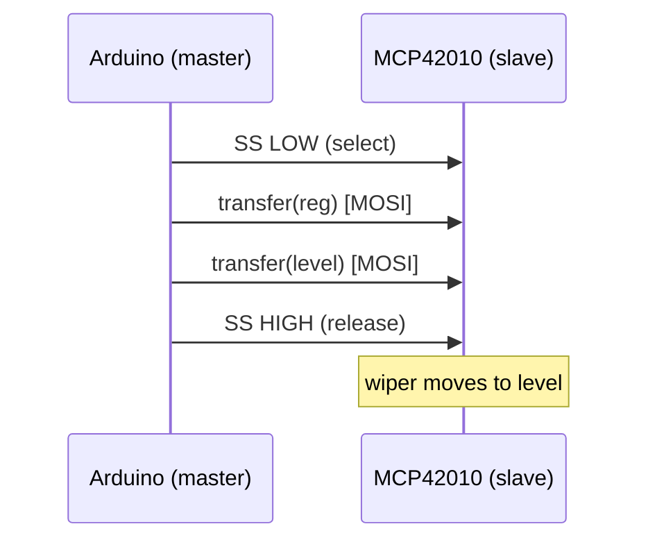

## For future agent
This note covers Episode 8 of Jeremy Blum's Arduino Tutorial Series — SPI (Serial Peripheral Interface). Key facts: SPI is a **4-wire, full-duplex, synchronous** bus with a **single master** and one-or-more slaves; lines are **MOSI** (master-out/slave-in, pin 11 on Uno), **MISO** (pin 12), **SCK** (clock, pin 13), and **SS** (slave select, default pin 10, **active low**). Jeremy drives an **Analog Devices MCP42010 digital potentiometer** (two/dual digital pots, 8-bit, 0–255) to fade three LEDs. Two gotchas: register numbering starts at **0** (so "LED 1" is register 0), and the MCP42010 needs the SPI clock slowed with `SPI.setClockDivider(SPI_CLOCK_DIV16)` — Jeremy found this after the datasheet's max clock was exceeded. Confidence: high.

# Episode 08 — SPI Interfaces

## Episode Overview

Episode 7 used I2C: two wires, addressed, moderate speed. Episode 8 introduces **SPI** (Serial Peripheral Interface) — the other workhorse bus in embedded systems. SPI uses **four** wires instead of two, but buys **much higher speed** and **full-duplex** transfer (send and receive at the same time). It trades I2C's addressing for **dedicated chip-select wires**.

The project: use an **MCP42010 digital potentiometer** — a chip whose "wiper positions" are set digitally over SPI — to control the brightness of three LEDs. This shows SPI talking to a chip that would normally need a real analog knob. It also deepens the PWM theme: instead of `analogWrite`, you command a chip that outputs true variable resistance.

Three ideas:

1. **The four SPI lines and the slave-select mechanism.** One clock, two data lines, one select per slave.
2. **Sending bytes and register addressing.** SPI is a raw byte stream; the meaning of the bytes comes from the slave's datasheet.
3. **Clock speed matters.** SPI can run faster than a slave supports; you may need to slow the master.

### Learning objectives
- Name SPI's four lines and their directions.
- Explain full-duplex and single-master operation.
- Use `SPI.begin()`, `SPI.transfer()`, and slave-select handling.
- Send register+value byte pairs to a slave and understand why order matters.
- Slow the SPI clock with `SPI.setClockDivider()` when a slave cannot keep up.
- Understand daisy-chaining (SCK/SS shared; data flows through chips in series).

---

## Core Concepts (ELI5)

### SPI's four wires
Think of SPI as a fast, private conversation between one boss and several workers who all share the same intercom except for one "listen to me" light per worker:

- **SCK / SCLK** — Serial CLocK. The master's metronome; every bit moves on a clock edge. Only the master drives it.
- **MOSI** — Master Out, Slave In. Data *from* the Arduino *to* devices. (Uno pin **11**.)
- **MISO** — Master In, Slave Out. Data *from* a device *back* to the Arduino. (Uno pin **12**.)
- **SS / CS** — Slave Select (a.k.a. Chip Select). One per slave, **active LOW**: pulling it low "selects" that device to talk. (Default Uno pin **10**.)

**Analogy:** the class shares a single announcer (SCK) and a shared speaker (MOSI) and a shared microphone (MISO), but each student also has their own call-button (SS). When the teacher wants student 3, they press only student 3's button; the others ignore the announcement. I2C instead calls by name; SPI flips a physical switch.

### Full duplex and speed
Unlike I2C (half-duplex, turn-based), SPI can send and receive **at the same instant**: while the master shifts a byte out on MOSI, a byte comes in on MISO. SPI is also simply faster — commonly many MHz. The trade-off: more wires (4 vs 2) and one select line per device (whereas I2C addresses many devices on the same two wires).

### Slave select (active low)
Crucially, SS/CS is **active low**: you must pull the pin **LOW** to select a device, and **HIGH** to let it go. Many students lose hours by forgetting to drive the select line at all (the device never hears) or by leaving it low so *all* devices respond. In code:

```cpp
digitalWrite(Slave, LOW);    // select this chip
SPI.transfer(reg);           // send register number
SPI.transfer(value);         // send value
digitalWrite(Slave, HIGH);   // release it
```

The configured output pins other than SS are handled automatically by the SPI library; only the select pin(s) are your job.

### The transfers are byte pairs here
SPI itself is just a byte pipe; the *slave's datasheet* defines what bytes mean. The MCP42010 expects **two bytes per command**: the first selects the register (0 or 1) and the second is the 8-bit value (0–255) for that digital pot. Register numbering starts at **0**, and the digital pot has **256** steps (8-bit). So "LED 1" is register 0.

### Clock speed and SPI_CLOCK_DIV
A slave has a **maximum clock rate**. If the Arduino's default SPI clock is too fast, the slave mis-reads bytes (or the first write "loses"). Jeremy discovered the MCP42010 could not keep up and added:

```cpp
SPI.setClockDivider(SPI_CLOCK_DIV16);   // 16 MHz / 16 = 1 MHz
```

The Uno runs at 16 MHz; dividing by 16 yields a comfortable 1 MHz. The divider names (`SPI_CLOCK_DIV2` … `SPI_CLOCK_DIV128`) let you match any slave's spec.

### Daisy-chaining
If devices share SCK and SS but their data lines are wired **in series** (one's output feeds the next's input), they form a **shift register chain**: bytes shift through the chain, and one SS pulse can update many chips. This is an elegant way to control dozens of outputs on one select line. Jeremy mentions it; it is a common SPI pattern (e.g., 74HC595 shift registers stretching three Arduino pins to many LEDs).

### The lesson for future sensors
Most SPI peripherals (SD cards, ADCs, accelerometers, displays) follow the same shape: pull SS low, send a command/address byte, send or receive data bytes, pull SS high — optionally set speed and mode. Episode 8 is the template.

---

## Code Walkthrough

### Full sketch — drive the digital pot over SPI

```cpp
// Episode 8 - SPI digital potentiometer
#include <SPI.h>

const int Slave = 10;    // chip-select pin (active low)

void setup() {
  pinMode(Slave, OUTPUT);      // we control SS ourselves
  digitalWrite(Slave, HIGH);   // keep unselected at rest
  SPI.begin();                 // initialise the SPI hardware
  SPI.setClockDivider(SPI_CLOCK_DIV16); // 1 MHz: match the MCP42010
}

// Set a digital-pot "register" (0 or 1) to a level 0..255
void setLed(byte reg, int level) {
  digitalWrite(Slave, LOW);    // select the chip
  SPI.transfer(reg);           // first byte: which pot
  SPI.transfer(level);         // second byte: the value
  digitalWrite(Slave, HIGH);   // release the chip
}

void loop() {
  // For each of the two/three pots, fade up then down in turn
  for (int pot = 0; pot < 3; pot++) {
    for (int level = 50; level <= 255; level++) {   // fade up
      setLed(pot, level);
      delay(20);
    }
    delay(300);                                     // hold
    for (int level = 255; level >= 50; level--) {   // fade down
      setLed(pot, level);
      delay(20);
    }
  }
}
```

**Reasoning.**

- `#include <SPI.h>` — bring in the SPI library (compare `#include <Wire.h>` for I2C).
- `Slave = 10` — only the SS pin must be set manually; MOSI/MISO/SCK are assigned by the library.
- `SPI.begin()` — initialises the SPI hardware, configuring pins 11/12/13.
- `SPI.setClockDivider(SPI_CLOCK_DIV16)` — slows the clock so the MCP42010 can follow (Jeremy's fix).
- `setLed(byte reg, int level)` — the two-byte protocol wrapped for convenience: select → register byte → value byte → deselect.
- Fading starts at **50**, not 0, because near zero the LED emits no visible light for a while; starting at 50 skips the "dead zone" (mirrors the Ep2/Ep10 note).
- Nested `for` loops sweep each register up and down — a pattern Jeremy calls out as a powerful use of nesting.

### Wiring (SPI)

```
   Arduino UNO          MCP42010 digital pot        LEDs
   -----------          -------------------         ----
   pin10 (SS)  --------> CS/SS
   pin11 (MOSI)-------> SI  (serial in)
   pin12 (MISO)<------- SO  (serial out)  [unused here]
   pin13 (SCK) --------> SCK
   +5V         --------> VDD, RS, SHDN (keep high)
   GND         --------> VSS
                        Wiper A0 --> [220R] --> LED --> GND
                        (A terminals -> +5V; B terminals -> GND via 10k)
```

Jeremy adds a **10 kΩ resistor to ground** on the "B" side so the pot only sweeps the top half of its range (2.5–5 V), because LEDs need ~2 V to light. This keeps the LEDs from spending most of their range off.

### Transfer flow



---

## Key Functions Reference

| Function | Syntax | What it does | Example |
|----------|--------|--------------|---------|
| `SPI.begin` | `SPI.begin()` | Init SPI hardware (pins 11/12/13). | `SPI.begin();` |
| `SPI.transfer` | `SPI.transfer(byte)` | Send one byte (and receive one). | `SPI.transfer(value);` |
| `setClockDivider` | `SPI.setClockDivider(div)` | Set SCK speed. | `SPI.setClockDivider(SPI_CLOCK_DIV16);` |
| `pinMode` (SS) | `pinMode(10, OUTPUT)` | Configure chip-select. | `pinMode(Slave, OUTPUT);` |
| `digitalWrite` (SS) | `digitalWrite(10, LOW/HIGH)` | Select/deselect (active low). | `digitalWrite(10, LOW);` |

**Uno SPI pins:** SS = 10, MOSI = 11, MISO = 12, SCK = 13. **MCP42010:** 8-bit (0–255), registers start at 0, two pots. **Clock:** default often too fast; DIV16 → 1 MHz works.

---

## Common Pitfalls / Gotchas

1. **Forgetting to select (SS LOW).** The slave never hears the transfer; nothing changes. Always wrap transfers in low/high.
2. **Leaving SS LOW.** Multiple slaves may respond or the bus stays busy. Deselect after each transaction.
3. **Active-low confusion.** SS must be **LOW** to select, **HIGH** to release.
4. **Register numbering starts at 0.** "LED 1" is register 0, "LED 2" is register 1 — off-by-one bugs are common.
5. **Clock too fast for the slave.** Missing/garbled first writes. Fix with `SPI.setClockDivider(...)` (Jeremy hit this with the MCP42010 and used DIV16 → 1 MHz).
6. **Assuming SPI has addressing.** It does not; each device needs its own SS pin (or daisy-chaining).
7. **Mixing up MOSI/MISO.** Crossed data lines mean the master listens to itself; check the pin labels.
8. **8-bit range confusion.** The digital pot is 0–255, not 0–1023 like `analogRead`. Do not map to 1023.
9. **Dead zone at low values.** LEDs are invisible below ~50 on the pot; start ramps above it (as Jeremy does).
10. **Forgetting `#include <SPI.h>`.** Compile failure.

---

## Practice Exercises

1. **Single pot, fixed level.** Set register 0 to 128 and confirm the LED holds mid-brightness. Then change 128 → 200.
2. **Two pots simultaneously.** Set both registers and confirm both LEDs respond independently.
3. **Speed experiment.** Try `SPI_CLOCK_DIV2`, then DIV128. Note when the MCP42010 starts to misbehave — this calibrates the datasheet's limit in practice.
4. **Smooth crossfade.** Write a loop that fades pot 0 up while fading pot 1 down, so LEDs crossfade.
5. **Daisy-chain reading.** Research the 74HC595 shift register and describe (in your own words) how three Arduino pins can drive dozens of outputs.

---

## Cross-Links

- [[01-Areas/Engineering/arduino-microcontrollers/INDEX|Arduino Module Index]]
- [[01-Areas/Engineering/arduino-microcontrollers/ep07-i2c-communication|Episode 07 — I2C]] — two-wire, addressed, slower; contrast with SPI.
- [[01-Areas/Engineering/arduino-microcontrollers/ep02-buttons-pwm-functions|Episode 02 — PWM]] — the same "variable brightness" goal, now via a chip.
- [[01-Areas/Engineering/nexus-robotics/nexus-theory-rapidfire|Nexus Robotics — theory rapid-fire]] — I2C vs SPI vs UART in the comms-buses section.
- [[01-Areas/Engineering/engineering-drawing/fusion/INDEX|Fusion 360 track]] — the CAD + 3MF companion thread for the Arduino → 3D-printing → robotics hardware path.
- [[01-Areas/Engineering/BEE/INDEX|Basic Electrical Engineering]] — digital vs analog signals.
