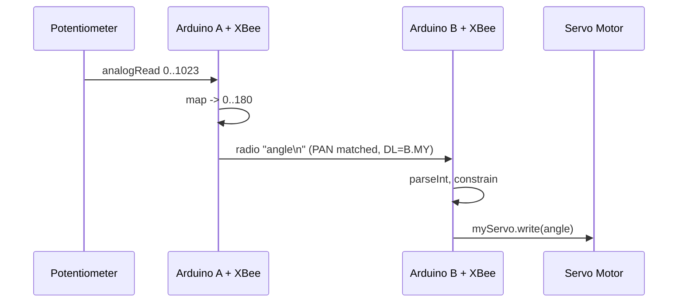

## For future agent
This note covers Episode 9 of Jeremy Blum's Arduino Tutorial Series — wireless communication with XBee. Key facts: XBee runs **802.15.4** (Series 1) or **ZigBee** (Series 2) at **2.4 GHz**; it is **3.3 V only** (a level shifter/divider or a proper shield is required on a 5 V Arduino). Configuration is done with **X-CTU** on a **PC** (X-CTU can be awkward on Mac). Critical parameters: **PAN ID** (network ID, both radios must match), **MY** (this radio's address), **DL** (destination address of the other radio), channel. In **transparent mode** the XBee is a wireless serial cable — `Serial.print` on one end appears at the other. Jeremy sends a potentiometer value wirelessly to drive a servo on a second Arduino. Two caution notes from his forum: XBee needs a regulated supply and can be configured without an Arduino using a USB explorer/divider board. Confidence: high, with version/caveats flagged.

# Episode 09 — Wireless Communication (XBee)

## Episode Overview

Every project so far was tethered — to USB, to wires. Episode 9 cuts the cord. It introduces the **XBee**, a small radio module that behaves like a **wireless serial cable**: whatever you write into one appears at the other, as if a (very long, invisible) wire connected the two serial ports. The project links **two Arduinos**: a sender with a potentiometer and a receiver driving a servo. Turn the knob on one bench; the motor moves on the other.

This is the first taste of networked embedded systems. The concepts — addressing, networks, pairing, baud rates, and supply constraints — recur in every wireless technology (Bluetooth, Wi-Fi, LoRa, ESP-NOW).

Three ideas:

1. **Transparent serial.** No new programming model: the same `Serial.print`/`Serial.read` from Episode 6, only over the air.
2. **Addressing and pairing.** Radios must be on the same network (PAN ID) and point at each other's addresses (MY/DL) before they talk.
3. **Electrical discipline.** XBee is a **3.3 V** device; feeding it 5 V logic destroys it. Regulation and level shifting matter.

### Learning objectives
- Explain what an XBee is and its role as a transparent serial bridge.
- Distinguish Series 1 (802.15.4) from Series 2 (ZigBee).
- Configure a radio with X-CTU: PAN ID, MY, DL, channel, baud.
- Wire XBee safely to a 5 V Arduino (voltage caution).
- Send sensor data wirelessly and actuate on the receiver.
- Know the practical limits of this approach.

---

## Core Concepts (ELI5)

### What is an XBee?
An **XBee** is a matchbox-sized radio that presents itself as a **serial port**. You do not "program" it with sketches; you configure it with settings, then treat it as a pipe. Feed bytes in one side, they come out the other side (if paired). It is the RF equivalent of the USB cable you have been uploading through.

**Analogy:** two walkie-talkies tuned to the same channel and set to talk only to each other. Press talk on one, the other hears. The XBee hides all the radio engineering behind a serial interface.

### 802.15.4 vs ZigBee (Series 1 vs Series 2)
- **Series 1** radios use **802.15.4**, a simple point-to-point / star protocol. Easy to configure, no coordinator required for basic two-way links. This is what the episode's project uses.
- **Series 2** radios use **ZigBee**, a mesh-networking standard where nodes are **Coordinator / Router / End Device**, forming self-healing mesh networks. More capable but more configuration (a coordinator must be defined).

For a straightforward two-Arduino link, Series 1 is the beginner-friendly choice. Both operate in the **2.4 GHz** band.

### The three addresses that matter
- **PAN ID** — the network ID. Both radios must share it, or they are on different "channels" (conceptually different networks).
- **MY** — this radio's own address (its "name").
- **DL** (Destination Low) — the address of the radio this one sends to. Pairing means each radio's DL points at the other's MY.

In transparent mode, a byte written goes to whatever radio is at DL. Setting DL correctly is the crux of the whole episode.

### Transparent mode
In the default ("transparent") mode, the XBee is fully automatic: bytes in via serial become RF packets, and RF packets to me come out my serial port. No framing, no addressing in the sketch — the radio handles it. This is why the sender/receiver sketches differ only in *what they do with the data*, not in *how it travels*.

### 3.3 volts — the non-negotiable
XBee runs at **3.3 V** — both power and logic. Arduino Uno logic is 5 V. 

- Feeding a 5 V signal into XBee data pins can damage it.
- XBee's regulated supply needs to be clean; brownouts cause config corruption or connection drops.

Solutions: use an **XBee shield** that handles level shifting and regulation, or a dedicated **breakout/explorer board** with a 3.3 V regulator and level converters. Jeremy uses the standard shield/wireless setup. Never power an XBee from a raw 5 V pin.

### Configuration with X-CTU
**X-CTU** is Digi's Windows configuration tool. It lets you connect to the XBee (via a USB explorer board), read its settings, and write PAN ID, MY, DL, baud rate, and channel. It can also do a **range test** and **firmware update**. Caveat: X-CTU is Windows-centric; Mac users often need alternate tools or a VM (Jeremy's channel notes this friction). You can also configure many settings with **AT commands** over a serial terminal (`+++` to enter command mode), but X-CTU is the friendly path.

### The demo pipeline
- **Sender Arduino:** reads a potentiometer (`analogRead`), maps to 0–180, prints the value on soft serial to the XBee.
- **Receiver Arduino:** reads the incoming bytes from its XBee over serial, parses the number, and drives the servo with `Servo.write()`.

Crucially, this reuses Ep4 (analog), Ep5 (servo), and Ep6 (serial). Episode 9 is mostly *integration* — the new material is the radio and its configuration.

### Baud rate
The XBee's serial rate must match the Arduino's serial rate (both 9600 here). The *over-the-air* rate is separate and faster; you do not set it in the sketch. Mismatched baud shows up as garbage bytes.

---

## Code Walkthrough

### Sender Arduino — pot over the air

```cpp
// Episode 9 - sender: read pot, transmit the angle wirelessly
#include <SoftwareSerial.h>

SoftwareSerial xbee(2, 3);   // RX, TX to the XBee (or use Serial directly)
int potPin = 0;
int angle = 0;

void setup() {
  xbee.begin(9600);          // match the XBee's configured baud
}

void loop() {
  int reading = analogRead(potPin);          // 0..1023
  angle = map(reading, 0, 1023, 0, 180);     // to servo degrees
  angle = constrain(angle, 0, 180);          // clamp
  xbee.print(angle);                         // send as text + newline
  xbee.print('\n');
  delay(50);
}
```

**Reasoning.** The XBee is a serial peripheral, so we talk to it with `print`. `SoftwareSerial` lets us keep USB `Serial` free for debugging. `map()` + `constrain()` are the now-familiar pair. `'\n'` marks message boundaries so the receiver knows where one number ends.

### Receiver Arduino — drive the servo

```cpp
// Episode 9 - receiver: get the angle wirelessly, move the servo
#include <SoftwareSerial.h>
#include <Servo.h>

SoftwareSerial xbee(2, 3);
Servo myServo;
int angle = 0;

void setup() {
  xbee.begin(9600);
  myServo.attach(9);
}

void loop() {
  if (xbee.available() > 0) {
    angle = xbee.parseInt();     // parse the incoming integer
    angle = constrain(angle, 0, 180);
    myServo.write(angle);
  }
}
```

**Reasoning.** `xbee.parseInt()` reads until a non-digit, so the newline terminates the number cleanly — far more robust than byte-by-byte math. `constrain()` guards against RF corruption sending an out-of-range angle. `if (available() > 0)` means the servo only updates when data actually arrives.

### Wiring / radio stack

```
  Sender side                          Receiver side
  -----------                          -------------
  Arduino --(serial)--> XBee A  ))))))  XBee B --(serial)--> Arduino
  pot on A0                            servo signal on pin 9
  PAN ID = same on both
  A.MY <--> B.DL ;  B.MY <--> A.DL
```

### Wireless flow



---

## Key Functions Reference

| Item | Syntax | What it does | Example |
|------|--------|--------------|---------|
| `SoftwareSerial` | `SoftwareSerial(rx,tx)` | Extra serial port on chosen pins. | `SoftwareSerial xbee(2,3);` |
| `begin` | `xbee.begin(9600)` | Open the radio serial port. | `xbee.begin(9600);` |
| `print` | `xbee.print(v)` | Send a value to the radio. | `xbee.print(angle);` |
| `parseInt` | `xbee.parseInt()` | Read an integer from the stream. | `angle = xbee.parseInt();` |
| `available` | `xbee.available()` | Bytes waiting. | `if(xbee.available()>0)` |

**XBee settings:** PAN ID (match both), MY (own address), DL (destination), baud 9600, 2.4 GHz. **Voltage:** 3.3 V only — use a shield/explorer. **Tool:** X-CTU (Windows).

---

## Common Pitfalls / Gotchas

1. **5 V into a 3.3 V XBee.** Damages or destroys the module. Use a shield or level shifter and a regulated 3.3 V supply.
2. **Mismatched PAN ID.** The radios are on different networks and never meet. Set both to the same PAN.
3. **Wrong DL / MY pairing.** If A's DL does not equal B's MY (and vice versa), data goes nowhere. This is the number-one setup error.
4. **Baud mismatch.** Garbage bytes. The XBee serial baud and the Arduino `begin` rate must agree.
5. **Dirty/unregulated supply.** Connection drops or corrupted config. XBee wants a clean, adequately current-rated 3.3 V.
6. **Series 1 vs Series 2 confusion.** Settings and topology differ (Series 2 needs a coordinator). Follow one family's guide consistently.
7. **X-CTU on Mac.** Awkward; often needs a Windows environment or an alternate tool.
8. **Forgetting to exit command mode.** If you entered AT command mode with `+++`, the radio passes bytes as commands, not data, until you exit.
9. **No message delimiter.** Without `'\n'`, `parseInt()` cannot tell where one number ends and the next begins.
10. **Expecting long range indoors.** Walls, 2.4 GHz Wi-Fi interference, and antenna choice all shrink range; the claimed outdoor line-of-sight distance is optimistic indoors.

---

## Practice Exercises

1. **Range test.** Using X-CTU's range test, walk the receiver around and note where packets drop. Compare indoors vs line-of-sight.
2. **Bidirectional link.** Add a button on the receiver that sends a "received" acknowledgement back to the sender; light an LED on the sender when it arrives.
3. **Three values.** Send pot, light sensor, and temperature as `a,b,c\n` and parse all three on the receiver.
4. **Address experiment.** Deliberately set the wrong DL and observe that nothing arrives; then fix it and explain why.
5. **Baud experiment.** Change the XBee's configured baud while leaving the sketch at 9600; observe garbage, then reconcile.

---

## Cross-Links

- [[01-Areas/Engineering/arduino-microcontrollers/INDEX|Arduino Module Index]]
- [[01-Areas/Engineering/arduino-microcontrollers/ep06-serial-processing|Episode 06 — Serial]] — the serial model the radio transparently carries.
- [[01-Areas/Engineering/arduino-microcontrollers/ep05-motors-transistors|Episode 05 — Motors & Servos]] — the servo being driven remotely.
- [[01-Areas/Engineering/arduino-microcontrollers/ep04-analog-inputs|Episode 04 — Analog Inputs]] — the potentiometer source.
- [[01-Areas/Engineering/arduino-microcontrollers/ep10-interrupts-debouncing|Episode 10 — Interrupts]] — handling incoming data without blocking.
- [[01-Areas/Engineering/robotics/ros2-communication|ROS2 communication]] — ROS topics/QoS are the software analogue of a wireless named channel.
- [[01-Areas/Engineering/robotics/ros2-architecture|ROS2 architecture]] — the next step beyond two Arduinos: distributed nodes over a network.
- [[01-Areas/Engineering/BEE/INDEX|Basic Electrical Engineering]] — regulated supplies and voltage levels.
